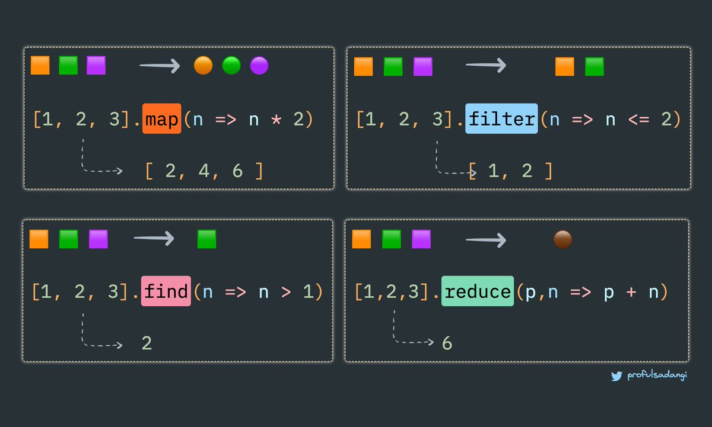

<a href="#top" id="backToTop" style="
    position: fixed;
    bottom: 20px;
    right: 20px;
    background: #007bff;
    color: white;
    padding: 8px 12px;
    border-radius: 6px;
    text-decoration: none;
    font-size: 14px;
">⬆ Top</a>

<script>
document.querySelector('#backToTop').addEventListener('click', function(e) {
    e.preventDefault();
    document.querySelector('#top').scrollIntoView({
        behavior: 'smooth'
    });
});
</script>


### **🔥 Most Important JavaScript Interview Questions**

---

### **Requested Icons (No images, only text icons)**

| Term           | Text Icon / Emoji |
| -------------- | ----------------- |
| **Concept**    | 💡                 |
| **Features**   | ⭐ / ⚙️             |
| **Techniques** | 🛠️                 |
| **Mechanism**  | 🔧 / ⚙️             |
| **Behavior**   | 🧠 / 📊             |

---


### 1. JavaScript Basics

- [What is JavaScript?](#what_is_javascript)

- [What are JavaScript data types?](#what_are_javascript_data_types)

- [What is the difference between `var`, `let`, and `const`?](#what_is_the_difference_between_var_let_and_const)

- [What is hoisting?](#what_is_hoisting)

- [What is the `typeof` operator?](#what_is_the_typeof_operator)

- [What are primitive and non-primitive values?](#what_are_primitive_and_non_primitive_values)

- [Mutable vs Immutable  and Value Type vs Reference Type and Primitive vs Non-Primitive and Implicit Type vs Explicit Type ?](#difference)

- [variable declaration vs assignment vs initialization](#variable_declaration_vs_assignment_vs_initialization)

- [What is NaN?](#what_is_nan)

- [What is strict mode?](#what_is_strict_mode)

- [What is the difference between `value` and `reference` types?](#what_is_the_difference_between_value_and_reference_types)

- [What is the use of semicolons in JavaScript?](#what_is_the_use_of_semicolons_in_javascript)

- [What is the difference between declaration and initialization?](#what_is_the_difference_between_declaration_and_initialization)

- [Implicit Type Conversion (Type Coercion)  and Explicit Type Conversion](#Implicit_and_Explicit_Type_Conversion)

- [What is short-circuit evaluation?](#what_is_short_circuit_evaluation)

- [What is the difference between `==` and `Object.is()`?](#what_is_the_difference_between_equale_and_object_is)

- [What is scope in JavaScript?](#what_is_scope_in_javascript)

---

### 2. Functions & Execution

- [Types of the Functions](#types_of_the_functions)

- [What is an arrow function?](#what_is_an_arrow_function)

- [What is a function expression?](#what_is_a_function_expression)

- [What is the `this` keyword?](#what_is_the_this_keyword)

- [What is a closure?](#what_is_a_closure)

- [What is lexical scope?](#what_is_lexical_scope)

- [What is an IIFE?](#what_is_an_iife)

- [What is recursion?](#what_is_recursion)

- [What are callbacks?](#what_are_callbacks)

- [What are higher-order functions?](#what_are_highe_order_functions)

- [What is currying?](#what_is_currying)

- [What is memoization?](#what_is_memoization)

- [What are the differences between `call()`, `apply()`, and `bind()`?](#what_are_the_differences_between_call_apply_and_bind)

- [What is debouncing?](#what_is_debouncing)

- [What is throttling?](#what_is_throttling)

- [What is the call stack?](#what_is_the_call_stack)

- [What are microtasks and macrotasks?](#what_are_microtasks_and_macrotasks)

### 3. Objects, Arrays, and Prototype


- [How can you create objects in JavaScript?](#how_can_you_create_objects_in_javascript)

- [Difference between dot notation and bracket notation?](#difference_between_dot_notation_and_bracket_notation)

- [What is prototypal inheritance?](#what_is_prototypal_inheritance)

- [What is the prototype chain?](#what_is_the_prototype_chain)

- [What is a constructor function?](#what_is_a_constructor_function)

- [What are ES6 classes?](#what_are_es6_classes)

- [What is `Object.create()`?](#what_is_object_create)

- [Difference between `Object.freeze()` and `Object.seal()`?](#difference_between_object_freeze_and_object_seal)

- [What is the difference between shallow and deep copy?](#what_is_the_difference_between_shallow_and_deep_copy)

- [How do you clone an object?](#how_do_you_clone_an_object)

-  What is destructuring?

- [What are Spread and Rest Operators in JavaScript?](#what_are_spread_and_rest_operators_in_javascript)

- [Difference between `slice()` and `splice()`?](#difference_between_slice_and_splice)

- [Difference between `map()`, `forEach()`, `filter()`, and `reduce()`?](#difference_between_map_foreach_filter_and_reduce)

- [How do you remove duplicates from an array?](#how_do_you_remove_duplicates_from_an_array)

- [How do you sort an array of objects?](#how_do_you_sort_an_array_of_objects)

- [What is array flattening?](#what_is_array_flattening)

- Difference between for...in and for...of
- How does garbage collection work?

### DOM & Browser

- [What is the DOM?](#what_is_the_dom)

- [What is the difference between `innerText`, `textContent`, and `innerHTML`?](#what_is_the_difference_between_innertext_textcontent_and_innerhtml)

- [How do you select DOM elements?](#how_do_you_select_dom_elements)

- [How do you create DOM elements dynamically?](#how_do_you_create_dom_elements_dynamically)

- [What is Event Propagation and Event Delegation?](#what_is_event_propagation_and_event_delegation)

- [What is event bubbling?](#what_is_event_bubbling)

- [What is event capturing?](#what_is_event_capturing)

- [What is event delegation?](#what_is_event_delegation)

- [What is `preventDefault()`?](#what_is_preventdefault)

- [What is `stopPropagation()`?](#what_is_stoppropagation)

- [What is the difference between `target` and `currentTarget`?](#what_is_the_difference_between_target_and_currenttarget)

- [What is a DOM event listener?](#what_is_a_dom_event_listener)

- [What are shadow DOM and virtual DOM?](#what_are_shadow_dom_and_virtual_dom)

- [What is `dataset` in HTML?](#what_is_dataset_in_html)


### Asynchronous JavaScript

- [What is AJAX?](#what_is_ajax)

- [What is asynchronous programming?](#what_is_asynchronous_programming)

- [What is a Promise?](#what_is_a_promise)

- [What is async/await?](#what_is_async_await)

- [What is callback hell. How do you avoid callback hell?](#what_is_callback_hell_how_do_you_avoid_callback_hell)

- [What is the fetch API?](#what_is_the_fetch_api)

- [What is the event loop?](#what_is_the_event_loop)

- [What are setTimeout and setInterval?](#what_are_settimeout_and_setinterval)

- [What is a Web Worker?](#what_is_a_web_worker)

- [What is a Service Worker?](#what_is_a_service_worker)

- [What is CORS?](#what_is_cors)

- [What is SOP (Same Origin Policy)?](#same_origin_policy)

- [What are SSE (Server-Sent Events)?](#what_are_sse)

- [What is long polling?](#what_is_long_polling)


### 6. ES6+ Features


-  [What are template literals?](#what_are_template_literals)

-  [What is a `Set`?](#what_is_a_set)

-  [What is a `Map`?](#what_is_a_map)

-  [What is a WeakMap?](#what_is_a_weakmap)

-  [What is a WeakSet?](#what_is_a_weakset)

-  [What are modules in JavaScript?](#what_are_modules_in_javascript)

-  [Difference between named and default exports?](#difference_between_named_and_default_exports)

-  [What is dynamic import?](#what_is_dynamic_import)

-  [What is the temporal dead zone?](#what_is_the_temporal_dead_zone)

-  [What is nullish coalescing?](#what_is_nullish_coalescing)

-  [What is optional chaining?](#what_is_optional_chaining)

-  What is Proxy?

-  What is Symbol and use cases?

-  What is top-level await?

-  What are private class fields?

-  What are static class methods?

-  What are logical assignment operators?


### Error Handling, Security & Performance

-  What is XSS. How do you prevent XSS in JavaScript?

-  What is CSRF?

-  What is CSP (Content Security Policy)?

-  What are types of JavaScript errors?

-  How do you throw custom errors?

-  What causes memory leaks in JS?

-  How to prevent memory leaks?

-  What is debouncing used for?

-  What is throttling used for?

-  What is lazy loading?

-  What is code splitting?

-  What is minification?

-  What is try/catch?

-  How do you optimize JS performance?


  <hr style="border: 2px solid green;">

  <h1 style="text-align:center;" >JavaScript Basics</h1>

  <hr style="border: 2px solid green;">


<h2 style="color:green; text-align:center;" id="what_is_javascript">What is JavaScript?</h2>


JavaScript is a **programming language** commonly used to make web pages interactive.

Here’s the simple breakdown:

- **Runs in the browser** (Chrome, Firefox, Safari, etc.).
- **Adds interactivity** to websites—like dropdowns, sliders, form validation, animations.
- **Works alongside HTML and CSS** to build modern web applications.
- **Also runs on servers** using environments like **Node.js**.
- **Event-driven and dynamic**, meaning it can react instantly to user actions.
- **One of the core technologies of the web**, used almost everywhere.


<hr style="border: 2px solid green;">

<h2 style="color:green; text-align:center;" id="what_are_javascript_data_types">What are JavaScript data types?</h2>


JavaScript has **8 main data types**. They fall into two categories: **primitive** and **non-primitive**.

---

### ✅ **Primitive Data Types (7 types)**

These hold a **single value** and are **immutable**.

1. **String**
   Text values.

   ```js
   let name = "John";
   ```

2. **Number**
   All numbers (integer, float, etc.).

   ```js
   let age = 25;
   ```

3. **BigInt**
   Large integers beyond Number limits.

   ```js
   let big = 12345678901234567890n;
   ```

4. **Boolean**
   Only `true` or `false`.

   ```js
   let isActive = true;
   ```

5. **Undefined**
   A variable declared but not assigned.

   ```js
   let x; // undefined
   ```

6. **Null**
   Intentional “empty” value.

   ```js
   let data = null;
   ```

7. **Symbol**
   Unique identifiers used mostly in advanced JS.

   ```js
   let id = Symbol("id");
   ```

---

### ✅ **Non-Primitive Data Type (1 type)**

8. **Object**
   Collections of key–value pairs.

   ```js
   let user = { name: "John", age: 20 };
   ```

Arrays, functions, dates—all are technically **objects**.

<hr style="border: 2px solid green;">

<h2 style="color:green; text-align:center;" id="what_is_the_difference_between_var_let_and_const">What is the difference between `var`, `let`, and `const`?</h2>

Here’s a clear and simple explanation of the differences between **`var`**, **`let`**, and **`const`** in JavaScript:

### ✅ **1. Scope**

| Keyword   | Scope Type     | Meaning                                  |
| --------- | -------------- | ---------------------------------------- |
| **var**   | Function scope | Visible inside the entire function.      |
| **let**   | Block scope    | Visible only inside `{ }` blocks.        |
| **const** | Block scope    | Same as `let`, but cannot be reassigned. |

---

### ✅ **2. Reassignment**

| Keyword   | Reassign Value?                         |
| --------- | --------------------------------------- |
| **var**   | ✔ Yes                                   |
| **let**   | ✔ Yes                                   |
| **const** | ❌ No (but object contents _can_ change) |

Example for `const` object:

```js
const user = { name: "John" };
user.name = "Peter"; // allowed
user = {}; // ❌ not allowed
```

---

### ✅ **3. Hoisting Behavior**

| Keyword   | Hoisted? | Usable Before Declaration?         |
| --------- | -------- | ---------------------------------- |
| **var**   | ✔ Yes    | ✔ Allowed (value = undefined)      |
| **let**   | ✔ Yes    | ❌ Not allowed (Temporal Dead Zone) |
| **const** | ✔ Yes    | ❌ Not allowed (TDZ)                |

Example:

```js
console.log(a); // undefined (var is hoisted)
var a = 10;

console.log(b); // ❌ error (let not usable before declare)
let b = 20;
```

---

### ✅ **4. Use Cases (Best Practices)**

- **Use `let`** for variables that will change.
- **Use `const`** for values that should not change.
- **Avoid `var`** in modern JavaScript (causes unexpected behavior).

<hr style="border: 2px solid green;">

<h2 style="color:green; text-align:center;" id="what_is_hoisting">What is hoisting?</h2>


**Hoisting** is JavaScript’s behavior of **moving variable and function declarations to the top of their scope** _before the code executes_.

In simple words:

> JavaScript reads all declarations first, then runs the code.

---

### ✅ **How hoisting works**

Only **declarations** are hoisted — **not** assignments.

### Example with `var`

```js
console.log(a); // undefined
var a = 10;
```

Behind the scenes:

```js
var a; // hoisted
console.log(a);
a = 10; // assignment stays here
```

---

### ✅ **Hoisting with `let` and `const`**

They are hoisted too, **but not initialized**, so you cannot use them before the declaration.

```js
console.log(b); // ❌ ReferenceError
let b = 20;
```

This happens because of the **Temporal Dead Zone (TDZ)**, the period before the variable is declared.

---

### ✅ **Hoisting with functions**

Function **declarations are fully hoisted**:

```js
sayHello(); // works

function sayHello() {
  console.log("Hello!");
}
```

But **function expressions** are not hoisted like declarations:

```js
sayHi(); // ❌ TypeError
var sayHi = function () {
  console.log("Hi!");
};
```

---

### 🚀 Summary

| Type                 | Hoisted?            | Usable Before Declaration? |
| -------------------- | ------------------- | -------------------------- |
| `var`                | ✔ Yes               | ✔ Yes (value = undefined)  |
| `let`                | ✔ Yes               | ❌ No (TDZ)                 |
| `const`              | ✔ Yes               | ❌ No (TDZ)                 |
| Function Declaration | ✔ Yes               | ✔ Yes                      |
| Function Expression  | ✔ Yes (as variable) | ❌ No                       |


<hr style="border: 2px solid green;">

<h2 style="color:green; text-align:center;" id="what_is_the_typeof_operator">What is the `typeof` operator?</h2>


The **`typeof` operator** in JavaScript is used to **check the data type** of a value or variable.
It returns the type as a **string**.

### ✅ **Examples**

```js
typeof "Hello"; // "string"
typeof 123; // "number"
typeof true; // "boolean"
typeof undefined; // "undefined"
typeof null; // "object"   // (JavaScript bug)
typeof {}; // "object"
typeof []; // "object"   // arrays are objects
typeof function () {}; // "function"
```

---

### ✅ **Key Points**

- It tells you **what type of data** a variable contains.
- It always returns a **string** (e.g., `"string"`, `"number"`).
- `typeof null` returning `"object"` is an old **JavaScript bug**, but kept for compatibility.
- Arrays return `"object"` because they are special kinds of objects.

---

<hr style="border: 2px solid green;">

<h2 style="color:green; text-align:center;" id="what_are_primitive_and_non_primitive_values">What are primitive and non-primitive values?</h2>

### ✅ **Primitive Values(Value Types)**

Primitive values are **simple**, **immutable**, and **stored directly** in memory.

### **Primitive types:**

1. **String**
2. **Number**
3. **Boolean**
4. **Undefined**
5. **Null**
6. **BigInt**
7. **Symbol**

### Example:

```js
let x = 10;
let y = x;
x = 20;

// y is still 10 (copy of value)
```
Primitive values are **copied by value**.
---

### ✅ **Non-Primitive Values (Reference Types)**

These are **objects**. They are **mutable**, and stored by **reference**, not by value.

### Includes:

- **Object**
- **Array**
- **Function**
- **Date**, **RegExp**, **Map**, **Set**, etc.

### Example:

```js
let obj1 = { name: "John" };
let obj2 = obj1;
obj1.name = "Peter";

// obj2 also changes because both refer to the same object
```

Non-primitive values are **copied by reference**.

---

### 🚀 Summary Table

| Feature   | Primitive    | Non-Primitive                     |
| --------- | ------------ | --------------------------------- |
| Stored as | Value        | Reference                         |
| Mutable?  | No           | Yes                               |
| Copied as | Value copy   | Reference copy                    |
| Types     | 7 primitives | Objects (arrays, functions, etc.) |

<hr style="border: 2px solid green;">

<h2 style="color:green; text-align:center;" id="difference">Mutable vs Immutable  and Value Type vs Reference Type and Primitive vs Non-Primitive and Implicit Type vs Explicit Type</h2>


### 🔁 **Mutable vs Immutable**

### 🟢 **Mutable (Can Change)**

* Value **can be updated**
* Stored as objects
  Examples:
* 🧱 Objects
* 📦 Arrays
* ⚙️ Functions

```js
let arr = [1, 2];
arr.push(3);  // changed
```

---

### 🔴 **Immutable (Cannot Change)**

* Value **cannot be modified**
* Creating a new value instead
  Examples (all primitives):
* 🔢 numbers
* 🔤 strings
* ✔️ booleans
* 🌑 null
* ❓ undefined
* 🧮 bigint
* 🌀 symbol

```js
let str = "Hi";
str = str + " there"; // new string created
```

---

### 🧩 **Value Type vs Reference Type**

### 📘 **Value Type**

* Stored **directly**
* Copied as **separate values**
* Changing one does **not** affect other
  Includes all **primitives**

```js
let a = 10;
let b = a;
a = 20;
console.log(b); // 10
```

---

### 📗 **Reference Type**

* Stored as a **reference/pointer**
* Copy points to the **same memory**
* Changing one affects the other
  Includes all **objects**

```js
let x = { name: "John" };
let y = x;
x.name = "Alex";
console.log(y.name); // Alex
```

---

### 🧱 **Primitive vs Non-Primitive**
### 🔹 **Primitive (Simple Values)**

* Immutable
* Value types
* Stored directly

Primitives:

* 🔢 number
* 🔤 string
* ✔️ boolean
* 🌑 null
* ❓ undefined
* 🧮 bigint
* 🌀 symbol

---

### 🔸 **Non-Primitive (Objects)**

* Mutable
* Reference types
* Stored as memory reference

Non-primitives:

* 🧱 object
* 📦 array
* ⚙️ function
* 📅 date
* 🔍 regexp

---

### 🔄 **Implicit vs Explicit Type**

### 🤖 **Implicit Type Conversion (Auto)**

JavaScript changes the type **automatically**.

```js
"5" * 2  // 10 (string → number)
"5" + 2  // "52" (number → string)
```

---

### 🧑‍💻 **Explicit Type Conversion (Manual)**

You convert the type yourself.

```js
Number("5")  // 5
String(10)   // "10"
Boolean(1)   // true
```

---

### 🧠 **Quick Cheat Sheet**

| Concept        | Icon | Meaning           |
| -------------- | ---- | ----------------- |
| Mutable        | 🔁    | Can change        |
| Immutable      | 🛑    | Cannot change     |
| Value Type     | 📘    | Stored directly   |
| Reference Type | 📗    | Stored by pointer |
| Primitive      | 🔹    | Simple, immutable |
| Non-Primitive  | 🔸    | Objects, mutable  |
| Implicit Type  | 🤖    | Auto conversion   |
| Explicit Type  | 🧑‍💻    | Manual conversion |


<hr style="border: 2px solid green;">

<h2 style="color:green; text-align:center;" id="variable_declaration_vs_assignment_vs_initialization">variable declaration vs assignment vs initialization in javascript</h2>


<hr style="border: 2px solid green;">

<h2 style="color:green; text-align:center;" id="what_is_nan">What is NaN?</h2>


**`NaN`** stands for **"Not-a-Number"**.
It is a special value in JavaScript that represents an **invalid number** or the result of a **failed numeric operation**.

---

### ✅ **When does `NaN` appear?**

### 1. Invalid mathematical operations

```js
0 / 0; // NaN
Math.sqrt(-1); // NaN
```

### 2. Converting non-numeric strings to numbers

```js
Number("abc"); // NaN
parseInt("Hi"); // NaN
```

### 3. Arithmetic with undefined or invalid values

```js
undefined + 5; // NaN
```

---

### ✅ **Important properties of NaN**

### ❗ 1. `NaN` is of type **number**

```js
typeof NaN; // "number"
```

### ❗ 2. `NaN` is the **only value that is not equal to itself**

```js
NaN === NaN; // false
```

### ❗ 3. To check if a value is `NaN`, use:

```js
Number.isNaN(value);
```
---

### 🚀 Summary

- `NaN` = Not-a-Number.
- Appears when a numeric operation fails.
- Its type is `"number"`.
- It never equals itself.
- Use `Number.isNaN()` to check it safely.

<hr style="border: 2px solid green;">

<h2 style="color:green; text-align:center;" id="what_is_strict_mode">What is strict mode?</h2>

 

### What is Strict Mode (`"use strict"`) ?

**Strict mode** is a feature in JavaScript that makes the code run in a **stricter**, more **secure**, and **error-sensitive** way.

You enable it by adding:

```js
"use strict";
```

at the top of a file or inside a function.

---

### ✅ **Why strict mode exists**

It helps:

- catch common coding mistakes
- prevent unsafe or buggy behaviors
- make JavaScript run more reliably

---

### ✅ **What strict mode does**

### 1. **Disallows using undeclared variables**

```js
"use strict";
x = 10; // ❌ Error: x is not defined
```

### 2. **Prevents duplicate parameter names**

```js
"use strict";
function test(a, a) {} // ❌ Error
```

### 3. **Makes `this` behave correctly**

In strict mode, `this` in a function that is not a method becomes **undefined** instead of the global object.

```js
"use strict";
function test() {
  console.log(this); // undefined
}
test();
```

### 4. **Prevents deleting variables or functions**

```js
"use strict";
let x = 5;
delete x; // ❌ Error
```

### 5. **Stops silent errors**

Some operations that would normally fail silently now throw real errors.

---

### 🚀 Summary

- `"use strict"` makes JavaScript behave more strictly and safely.
- Helps catch bugs earlier.
- Blocks bad syntax and unsafe actions.

<hr style="border: 2px solid green;">

<h2 style="color:green; text-align:center;" id="what_is_the_difference_between_value_and_reference_types">What is the difference between `value` and `reference` types?</h2>


### **Difference Between Value and Reference Types**

In JavaScript, data is stored in two ways: **value types** and **reference types**.

---

### ✅ **1. Value Types (Primitive Values)**

These include:

- Number
- String
- Boolean
- Null
- Undefined
- Symbol
- BigInt

### ✔ Stored **directly** in memory

### ✔ Copied **by value**

Meaning a new, independent copy is created.

#### Example:

```js
let a = 10;
let b = a; // b gets a COPY of a
a = 20;

console.log(b); // 10 (not affected)
```
---

### ✅ **2. Reference Types (Non-Primitive Values)**

These include:

- Object
- Array
- Function
- Date, Map, Set, etc.

### ✔ Stored as **references (pointers)**

### ✔ Copied **by reference**

Meaning both variables point to the **same memory location**.

#### Example:

```js
let obj1 = { name: "John" };
let obj2 = obj1; // both refer to same object
obj1.name = "Peter";

console.log(obj2.name); // "Peter" (affected)
```

---

### 🚀 **Summary Table**

| Feature       | Value Types                   | Reference Types            |
| ------------- | ----------------------------- | -------------------------- |
| Stored as     | Actual value                  | Memory address (reference) |
| Copy behavior | Copy of value                 | Copy of reference          |
| Mutability    | Immutable                     | Mutable                    |
| Examples      | string, number, boolean, etc. | objects, arrays, functions |

---

<hr style="border: 2px solid green;">

<h2 style="color:green; text-align:center;" id="what_is_the_use_of_semicolons_in_javascript">What is the use of semicolons in JavaScript?</h2>


In JavaScript, **semicolons (`;`) are used to mark the end of a statement**.

Example:

```js
let x = 10;
console.log(x);
```

---

### ✅ **Why semicolons are used**

Semicolons:

1. **Separate statements**
2. **Prevent automatic semicolon insertion (ASI) errors**
3. Make your code **more predictable and cleaner**

---

### ⚠️ **JavaScript uses Automatic Semicolon Insertion (ASI)**

JavaScript can automatically insert semicolons **when you omit them**.

Example (valid without semicolon):

```js
let x = 10;
console.log(x);
```

But **ASI sometimes fails** and creates bugs.

---

### ❗ Example where missing semicolon breaks code

```js
let a = 5;
let b = a(10 + 20).toString();
```

JavaScript reads it as:

```js
let b = a(10 + 20).toString(); // ❌ Error
```

If you add semicolons:

```js
let a = 5;
let b = a;
(10 + 20).toString(); // ✔ Works
```

---

### 🚀 Summary

- Semicolons end statements.
- They avoid ASI-related bugs.
- JavaScript **can** work without them, but using semicolons is safer.

---

Ready for the next question!

<hr style="border: 2px solid green;">

<h2 style="color:green; text-align:center;" id="what_is_the_difference_between_declaration_and_initialization">What is the difference between declaration and initialization(or assignment)?</h2>

### ✅ **1. Declaration**

Declaration means **creating a variable** (telling JavaScript it exists).

Example:

```js
let x;
```

The variable `x` is **declared** but not given a value.
Its value is automatically **undefined**.

---

### ✅ **2. Initialization (or assignment)**

Initialization means **giving a value** to the declared variable.

Example:

```js
x = 10; // initialization (assigning value)
```

You can also declare and initialize at the same time:

```js
let y = 20;
```

---

### 🚀 **Summary Table**

| Action             | Meaning               | Example      |
| ------------------ | --------------------- | ------------ |
| **Declaration**    | Creating the variable | `let a;`     |
| **Initialization** | Giving it a value     | `a = 5;`     |
| **Both together**  | Declare + initialize  | `let a = 5;` |

<hr style="border: 2px solid green;">


<h2 style="color:green; text-align:center;" id="Implicit_and_Explicit_Type_Conversion" > Implicit Type Conversion (Type Coercion) and Explicit Type Conversion ? </h2>


### ⭐ **Implicit Type Conversion (Type Coercion)**

### **Definition (Simple Answer)**

**Implicit type conversion**, also called **type coercion**, happens when **JavaScript automatically converts a value from one type to another** *behind the scenes*.

You did NOT convert it manually — JS did it for you.

---

### ✅ Examples

### 1️⃣ String + Number → String

```javascript
console.log("10" + 5); 
// "105"  (number 5 is converted to string)
```

### 2️⃣ Number + Boolean

```javascript
console.log(10 + true);
// 11  (true becomes 1)
```

### 3️⃣ Equality comparison

```javascript
console.log("10" == 10); 
// true  ("10" is converted to number)
```

---

### ⭐ Interview One-Liner

**Implicit type conversion is when JavaScript automatically converts one data type to another during operations.**

---

### ⭐ **Explicit Type Conversion (Type Casting)**

### **Definition (Simple Answer)**

**Explicit type conversion** is when **you manually convert a value to another type** using built-in functions.

You convert it *yourself*, not JavaScript.

---

### ✅ Examples

### 1️⃣ String → Number

```javascript
Number("10");  // 10
```

### 2️⃣ Anything → String

```javascript
String(123);   // "123"
```

### 3️⃣ Boolean → Number

```javascript
Number(true); // 1
Number(false); // 0
```

### 4️⃣ Number → String using `toString()`

```javascript
(50).toString(); // "50"
```

---

### ⭐ Interview One-Liner

**Explicit type conversion is when the developer manually converts data types using functions like `Number()`, `String()`, or `Boolean()`.**

<hr style="border: 2px solid green;">

<h2 style="color:green; text-align:center;" id="what_is_short_circuit_evaluation">What is short-circuit evaluation?</h2>


**Short-circuit evaluation** is a behavior in JavaScript where **logical operators** (`&&` and `||`) stop evaluating as soon as the final result is known.

---

### ✅ **1. AND operator (`&&`)**

In `A && B`:

- If **A is false**, JavaScript **does not check B**
- It returns the **first false value**

### Example:

```js
false && "Hello"; // false
0 && 5; // 0
```

### Only if A is true:

```js
true && "Hello"; // "Hello"
```

---


### ✔ **Short-Circuit for `&&` (AND)**

👉 AND stops **as soon as one condition is false**

### **Diagram (Very Clear)**

```
a condition
     |
     |-- is a FALSE? --> YES → STOP → return a
     |
     NO (a is TRUE)
     |
     v
b condition
     |
     |-- is b FALSE? --> YES → STOP → return b
     |
     NO (b is TRUE)
     |
     v
c condition
     |
     |-- is c FALSE? --> YES → STOP → return c
     |
     NO (c is TRUE)
     |
     v
Return c  (all true → AND returns last value)
```

### **Flow Summary**

* If **a** is false → stops → returns **a**
* If **a is true but b is false** → stops → returns **b**
* If **a, b are true but c is false** → stops → returns **c**
* If **all are true** → returns **c**


### ✅ **2. OR operator (`||`)**

In `A || B`:

- If **A is true**, JavaScript **does not check B**
- It returns the **first true value**

### Example:

```js
true || "Hello"; // true
"Hi" || 0; // "Hi"
```

### Only if A is false:

```js
0 || "Hello"; // "Hello"
```

---

### 🚀 **Why short-circuit evaluation is useful**

- To set **default values**

```js
let name = userName || "Guest";
```

- To check conditions safely

```js
user && user.profile && user.profile.name;
```

### ✔ **Short-Circuit for `||` (OR)**

👉 OR stops **as soon as one condition is true**

### **Diagram (Very Clear)**

```
a condition
     |
     |-- is a TRUE? → YES → STOP → return a
     |
     NO (a is FALSE)
     |
     v
b condition
     |
     |-- is b TRUE? → YES → STOP → return b
     |
     NO (b is FALSE)
     |
     v
c condition
     |
     |-- is c TRUE? → YES → STOP → return c
     |
     NO (c is FALSE)
     |
     v
Return c  (all false → OR returns last value)
```

### **Flow Summary**

* If **a** is true → stops → returns **a**
* If **a false but b true** → stops → returns **b**
* If **a, b false but c true** → stops → returns **c**
* If **all are false** → returns **c**

---


<hr style="border: 2px solid green;">

<h2 style="color:green; text-align:center;" id="what_is_the_difference_between_equale_and_object_is">What is the difference between `==` and `Object.is()`?</h2>

### **1. `==` (Loose Equality)**

`==` compares two values **after performing type coercion**.

✔ Converts types if needed
✔ Can produce unexpected results
✔ Easy to misuse

### Examples:

```js
5 == "5"; // true  (string → number)
0 == false; // true  (boolean → number)
null == undefined; // true
```

---

### **2. `Object.is()`**

`Object.is()` checks **strict equality without type coercion**,
but with **more accurate handling** of special cases.

✔ No type conversion
✔ Correctly compares tricky values
✔ More precise than `===` in some cases

### Examples:

```js
Object.is(5, "5"); // false
Object.is(0, -0); // false   (=== treats them as equal)
Object.is(NaN, NaN); // true    (=== says false)
Object.is(true, true); // true
```

---

### 🚀 **Key Differences**

| Feature         | `==`        | `Object.is()`           |
| --------------- | ----------- | ----------------------- |
| Type coercion?  | ✔ Yes       | ❌ No                    |
| NaN equals NaN? | ❌ No        | ✔ Yes                   |
| 0 equals -0?    | ✔ Yes       | ❌ No                    |
| Accuracy        | Low (loose) | Very high               |
| Best for        | Never use   | Checking exact equality |

---

### **Summary**

- `==` → loose equality (with type conversion)
- `Object.is()` → strict, accurate equality (even better than `===` in edge cases)

<hr style="border: 2px solid green;">

<h2 style="color:green; text-align:center;" id="what_is_scope_in_javascript"> What is Scope in JavaScript?</h2>


JavaScript has **3 main scopes**:

1. **Global Scope**
2. **Function Scope**
3. **Block Scope** (`{}` like `if`, `for`, `while`)

---

### Key Rules (Very Important)

### `var`

* **Function-scoped**
* ❌ NOT block-scoped

### `let` and `const`

* **Block-scoped**
* ✅ Respect `{}`

---

### 1️⃣ Declared in **Global Scope**

```js
var a = 1;
let b = 2;
const c = 3;
```

| Can Access From | `var` | `let` | `const` |
| --------------- | ----- | ----- | ------- |
| Global Scope    | ✅     | ✅     | ✅       |
| Function Scope  | ✅     | ✅     | ✅       |
| Block Scope     | ✅     | ✅     | ✅       |

✔️ **All are accessible everywhere below global**

---

### 2️⃣ Declared in **Function Scope**

```js
function test() {
  var a = 1;
  let b = 2;
  const c = 3;
}
```

| Can Access From | `var` | `let` | `const` |
| --------------- | ----- | ----- | ------- |
| Global Scope    | ❌     | ❌     | ❌       |
| Function Scope  | ✅     | ✅     | ✅       |
| Block Scope     | ✅     | ✅     | ✅       |

✔️ **None escape the function**

---

### 3️⃣ Declared in **Block Scope**

```js
function test() {
  if (true) {
    var a = 1;
    let b = 2;
    const c = 3;
  }
}
```

| Can Access From | `var` | `let` | `const` |
| --------------- | ----- | ----- | ------- |
| Global Scope    | ❌     | ❌     | ❌       |
| Function Scope  | ✅     | ❌     | ❌       |
| Block Scope     | ✅     | ✅     | ✅       |

### ⚠️ Important Correction

Your statement:

> Var can access from Block Scope, Function Scope

✅ **Correct**
But remember:

* `var` **ignores block scope**
* It becomes **function-scoped**

---

### 🔑 One-Line Summary

| Keyword | Scope Type     |
| ------- | -------------- |
| `var`   | Function Scope |
| `let`   | Block Scope    |
| `const` | Block Scope    |

---

### 🧠 Best Practice (Real-World Use)

* ❌ Avoid `var`
* ✅ Use `let` (when value changes)
* ✅ Use `const` (default choice)

---


<hr style="border: 2px solid green;">
<h1 style="text-align:center;" >Functions & Execution</h1>
<hr style="border: 2px solid green;">

<h2 style="color:green; text-align:center;"  id="types_of_the_functions"> Types of Functions in JavaScript</h2>


### 1️⃣ **Function Declaration (Named Function)**

Defined with the `function` keyword.

```javascript
function add(a, b) {
  return a + b;
}
```

✔ Hoisted (can be called before definition)

---

### 2️⃣ **Function Expression**

Assigned to a variable.

```javascript
const add = function(a, b) {
  return a + b;
};
```

❌ Not hoisted like declarations.

---

### 3️⃣ **Anonymous Function**

Function without a name (often inside callbacks).

```javascript
setTimeout(function() {
  console.log("Hello");
}, 1000);
```

---

### 4️⃣ **Arrow Function (ES6)**

Shorter syntax, does not have its own `this`.

```javascript
const add = (a, b) => a + b;
```

---

### 5️⃣ **IIFE — Immediately Invoked Function Expression**

Runs immediately.

```javascript
(function() {
  console.log("IIFE runs immediately");
})();
```

---

### 6️⃣ **Callback Function**

A function passed as an argument.

```javascript
function greet(name, callback) {
  callback(name);
}

greet("John", function(n) {
  console.log("Hello", n);
});
```

---

### 7️⃣ **Higher-Order Function**

A function that takes or returns another function.

```javascript
function multiplier(x) {
  return function(y) {
    return x * y;
  };
}

const double = multiplier(2);
console.log(double(5)); // 10
```

---

### 8️⃣ **Constructor Function**

Used with `new` to create objects.

```javascript
function Person(name) {
  this.name = name;
}

const p = new Person("Ali");
```

---

### 9️⃣ **Generator Function (`function*`)**

Used to generate values step by step.

```javascript
function* numbers() {
  yield 1;
  yield 2;
  yield 3;
}

const gen = numbers();
console.log(gen.next());
```

---

### 🔟 **Async Function**

Returns a Promise.

```javascript
async function fetchData() {
  return "Done";
}
```

---

### 1️⃣1️⃣ **Method**

Function inside an object.

```javascript
const user = {
  sayHi() {
    console.log("Hi");
  }
};
```

---

### 1️⃣2️⃣ **Class Method / Static Method**

```javascript
class Car {
  start() {
    console.log("start");
  }

  static info() {
    console.log("Static method");
  }
}
```

---

### ⭐ Summary Table

| Type                  | Example                    | Hoisted? | Notes                  |
| --------------------- | -------------------------- | -------- | ---------------------- |
| Function Declaration  | `function a(){}`           | ✔ Yes    | Has hoisting           |
| Function Expression   | `const a = function(){}`   | ❌ No     | Often anonymous        |
| Arrow Function        | `()=>{}`                   | ❌ No     | No `this`, `arguments` |
| Anonymous Function    | `function(){}`             | —        | Used for callbacks     |
| IIFE                  | `(function(){})()`         | —        | Runs immediately       |
| Callback Function     | Passed to another function | —        | Used in async logic    |
| Higher-Order Function | Returns/accepts function   | —        | Functional programming |
| Constructor Function  | `new Person()`             | —        | Before ES6 classes     |
| Generator             | `function*`                | —        | `yield`                |
| Async Function        | `async function`           | —        | Returns Promise        |
| Method                | `{ sayHi(){} }`            | —        | Inside object          |
| Class/Static Method   | `static info()`            | —        | Called on class        |

---


<hr style="border: 2px solid green;">

 <h2 style="color:green; text-align:center;" id="what_is_an_arrow_function">  What is an arrow function? </h2>


**Arrow functions** are a **shorter way** to write functions in JavaScript.
They were introduced in **ES6 (ES2015)** to make code simpler and cleaner.

### 📘 **Example — Normal Function vs Arrow Function**

**Regular function:**

```js
function add(a, b) {
  return a + b;
}
```

**Arrow function:**

```js
const add = (a, b) => a + b;
```

✅ Both do the same thing, but the arrow function is shorter and easier to read.

---

### ⚙️ **Rules & Features**

1. If there’s **only one line**, you can skip `{}` and `return`.

   ```js
   const greet = () => "Hello!";
   ```

2. If there’s **only one parameter**, you can skip the parentheses.

   ```js
   const square = (x) => x * x;
   ```

3. Arrow functions **don’t have their own `this`** —
   they **use `this` from the surrounding scope** (lexical `this`).

---

### ⚠️ **Example — `this` Difference:**

```js
const person = {
  name: "John",
  sayHi: () => console.log("Hi " + this.name),
};

person.sayHi(); // Output: "Hi undefined" ❌
```

Here, arrow functions don’t bind `this` to `person`;
they take it from the outer (global) scope.

---

### 🎯 **In short:**

> **Arrow functions** are **shorter and simpler** function syntax introduced in ES6,
> but they **don’t have their own `this`, `arguments`, or `prototype`.**

<hr style="border: 2px solid green;">

 <h2 style="color:green; text-align:center;" id="what_is_a_function_expression">  What is a function expression? </h2>

A **function expression** is a function that is **assigned to a variable**, rather than declared with a name.

It is created at the time the code runs (runtime), not hoisted like a function declaration.

---

### ✅ **Example of a function expression**

```js
const greet = function () {
  console.log("Hello!");
};
```

Here, the function is **anonymous** (has no name) and is assigned to `greet`.

You call it like this:

```js
greet();
```

---

### 🚀 **Key Characteristics of Function Expressions**

### ✔ **1. Not hoisted** like function declarations

You cannot use them before they are defined.

```js
sayHi(); // ❌ Error

const sayHi = function () {
  console.log("Hi");
};
```

---

### ✔ **2. Can be anonymous or named**

Anonymous:

```js
const a = function () {};
```

Named:

```js
const b = function myFunc() {};
```

---

### ✔ **3. Often used in callbacks**

```js
setTimeout(function () {
  console.log("Done");
}, 1000);
```

---

### **Summary**

- A function expression is a function stored in a variable.
- It is not hoisted.
- It can be anonymous or named.
- Commonly used in callbacks.

<hr style="border: 2px solid green;">

 <h2 style="color:green; text-align:center;" id="what_is_the_this_keyword">  What is the `this` keyword? </h2>

`this` is a special keyword in JavaScript that refers to the **current execution context** — meaning **the object that is calling the function**.

Its value changes depending on **how** and **where** a function is called.

---

### ✅ **1. In an object method**

`this` refers to **the object**.

```js
const user = {
  name: "John",
  show() {
    console.log(this.name);
  },
};

user.show(); // "John"
```

---

### ✅ **2. In a regular function (non-strict mode)**

`this` refers to the **global object** (`window` in browsers).

```js
function test() {
  console.log(this);
}

test(); // window
```

---

### ✅ **3. In strict mode**

`this` becomes **undefined** inside regular functions.

```js
"use strict";

function test() {
  console.log(this);
}

test(); // undefined
```

---

### ✅ **4. In event listeners**

`this` refers to the **DOM element** that received the event.

```js
button.addEventListener("click", function () {
  console.log(this); // the button element
});
```

---

### ✅ **5. In arrow functions**

Arrow functions **do not have their own `this`**.
They **inherit** `this` from the parent scope (lexical `this`).

```js
const obj = {
  name: "John",
  show: () => {
    console.log(this); // NOT obj → inherits from outer scope
  },
};

obj.show();
```

---

### **Summary**

`this` refers to **who is calling the function**:

| Situation                    | `this` refers to                            |
| ---------------------------- | ------------------------------------------- |
| Method inside object         | The object                                  |
| Regular function             | Global object (or undefined in strict mode) |
| Arrow function               | Inherited parent `this`                     |
| Event listener               | The DOM element                             |
| Constructor function / class | New instance                                |

If you want, I can give real interview trick questions about `this`.

<hr style="border: 2px solid green;">

<h2 style="color:green; text-align:center;" id="what_is_a_closure">What is a closure?</h2>


A closure is a function that remembers and can access its outer function’s variables even after the outer function has finished executing.


In simple words:

> A closure allows a function to **keep using** variables **outside its own scope**.

---

### ✅ **Example**

```js
function outer() {
  let count = 0;

  function inner() {
    console.log(count); // inner can access count
  }

  return inner;
}

const fn = outer();
fn(); // 0
```

Even though `outer()` has finished running,
the inner function still **remembers** `count`.

---

### 🚀 Why closures are useful

- Private variables
- Function factories
- Module pattern
- Maintaining state without classes

### Example: Private variable

```js
function counter() {
  let num = 0;

  return function () {
    num++;
    return num;
  };
}

const c = counter();
c(); // 1
c(); // 2
c(); // 3
```

`num` stays private inside the closure.

---

### **Summary**

- Closure = inner function + lexical environment.
- Lets a function remember variables from its parent scope.
- Useful for private data and state management.

<hr style="border: 2px solid green;">

<h2 style="color:green; text-align:center;" id="what_is_lexical_scope">What is lexical scope?</h2>


Lexical scope means that variable access is determined by where the code is written (its position in the source code), not by where it is called.


In simple terms:

> Variables are accessible based on their **physical location** in the source code.

---

### ✅ **How lexical scope works**

Inner functions can access:

- their own variables
- variables from their outer (parent) functions
- variables from the global scope

But outer functions **cannot** access variables inside inner functions.

---

### ✅ **Example**

```js
function outer() {
  let x = 10;

  function inner() {
    console.log(x); // inner can access outer’s variable
  }

  inner();
}

outer();
```

Because `inner` is **written inside** `outer`, it has access to `outer`'s scope.

---

### 🚫 **Outer cannot access inner variables**

```js
function outer() {
  let x = 10;

  function inner() {
    let y = 20;
  }

  console.log(y); // ❌ Error: y is not defined
}
```

---

### 🚀 **Summary**

- Lexical scope is determined by **code structure**, not function calls.
- Inner functions can access outer variables.
- Outer functions cannot access inner variables.
- Lexical scope enables **closures**.


<hr style="border: 2px solid green;">

<h2 style="color:green; text-align:center;" id="what_is_an_iife">What is an IIFE?</h2>


An **IIFE** stands for **Immediately Invoked Function Expression**.

It is a function that is:

1. **Defined**, and
2. **Executed immediately** (without being called later)

---

### ✅ **Basic syntax**

```js
(function () {
  console.log("IIFE running!");
})();
```

- The function is wrapped in parentheses → makes it an **expression**, not a declaration.
- The final `()` immediately **executes** it.

---

### ✅ **Why use an IIFE?**

### ✔ 1. To avoid polluting the global scope

Variables inside an IIFE stay **private**.

```js
(function () {
  let secret = "hidden";
})();
console.log(secret); // ❌ Error
```

### ✔ 2. To create private variables and modules

### ✔ 3. To run setup code immediately

### ✔ 4. Commonly used before ES6 modules existed

---

### ✔ Example with parameters

```js
(function (name) {
  console.log("Hello " + name);
})("John");
```

---

### **Summary**

- IIFE = function executed right after it is created.
- Keeps variables private.
- Prevents global scope pollution.
- Often used for initialization code.

<hr style="border: 2px solid green;">

<h2 style="color:green; text-align:center;" id="what_is_recursion">What is recursion?</h2>


**Recursion** is a technique where a function **calls itself** to solve a problem.

A recursive function must have:

1. **Base case** → stops the recursion
2. **Recursive case** → the function calling itself again with a smaller/simpler input

---

### **Example**

```js
function countdown(n) {
  if (n === 0) return; // base case
  console.log(n);
  countdown(n - 1); // recursive call
}
```

---

### **In simple words**

Recursion is when a function solves a problem by breaking it into smaller versions of itself until it reaches a stopping point.

<hr style="border: 2px solid green;">

<h2 style="color:green; text-align:center;" id="what_are_callbacks">What are callbacks function?</h2>

A **callback** is a **function passed as an argument to another function**, and it runs **after an asynchronous task completes**.

It’s how Node.js handles async operations like reading files, making requests, or waiting for timers—*without blocking the program*.

---

### ✅ Example

```js
function greet(name, callback) {
  console.log("Hello " + name);
  callback();
}

greet("John", function () {
  console.log("Welcome!");
});
```

---

### ✔ Why callbacks are used?

- To handle **asynchronous operations** (like API calls, timers, reading files)
- To execute code **after** something else completes
- To customize function behavior

---

### 🕒 Asynchronous callback example

```js
setTimeout(function () {
  console.log("This runs later");
}, 1000);
```

---

### Summary

- A callback is a function passed to another function.
- It runs after the first function finishes or when an event occurs.
- Common in asynchronous JavaScript.

Want the next one?

<hr style="border: 2px solid green;">

<h2 style="color:green; text-align:center;" id="what_are_highe_order_functions">What are higher-order functions?</h2>


A **higher-order function (HOF)** is a function that does **at least one** of the following:

1. **Takes another function as an argument**, OR
2. **Returns a function**

If a function does either of those, it is a higher-order function.

---

### ✅ Example: Taking a function as an argument

```js
function repeat(n, callback) {
  for (let i = 0; i < n; i++) {
    callback();
  }
}

repeat(3, () => console.log("Hello"));
```

---

### ✅ Example: Returning a function

```js
function multiplyBy(n) {
  return function (x) {
    return x * n;
  };
}

const double = multiplyBy(2);
console.log(double(5)); // 10
```

---

### ✔ Common higher-order functions in JavaScript

- `map()`
- `filter()`
- `reduce()`
- `forEach()`
- `setTimeout()`
- Event listeners

---

### **Summary**

A higher-order function is any function that **accepts a function**, **returns a function**, or **does both**.

<hr style="border: 2px solid green;">

<h2 style="color:green; text-align:center;" id="what_is_currying">What is currying?</h2>


**Currying** is a technique where a function that takes multiple arguments is transformed into **a series of functions**, each taking **one argument at a time**.

Instead of:

```js
func(a, b, c);
```

Currying makes it:

```js
func(a)(b)(c);
```

---

### ✅ Example of a curried function

```js
function curryAdd(a) {
  return function (b) {
    return function (c) {
      return a + b + c;
    };
  };
}

console.log(curryAdd(1)(2)(3)); // 6
```

---

### ✅ Why use currying?

- Reuse functions with preset values (partial application)
- More flexibility in function composition
- Cleaner functional programming style

---

### ✔ Example: Partial application

```js
function multiply(a) {
  return function (b) {
    return a * b;
  };
}

const double = multiply(2);
console.log(double(10)); // 20
```

---

### **Summary**

Currying breaks a multi-argument function into a chain of single-argument functions, allowing more reusable and flexible functional code.

<hr style="border: 2px solid green;">

<h2 style="color:green; text-align:center;" id="what_is_memoization">What is memoization?</h2>


**Memoization** is an optimization technique where a function **stores the results** of expensive calculations and **reuses** them when the same inputs occur again.

In simple words:
**Memoization = caching function results.**

---

### ✅ Example: Without memoization

```js
function slowSquare(n) {
  console.log("Calculating...");
  return n * n;
}

slowSquare(5); // Calculating... → 25
slowSquare(5); // Calculating... → 25  (repeated work!)
```

---

### ✅ Example: With memoization

```js
function memoizedSquare() {
  const cache = {};

  return function (n) {
    if (cache[n]) {
      return cache[n]; // return from cache
    }
    console.log("Calculating...");
    cache[n] = n * n; // store in cache
    return cache[n];
  };
}

const square = memoizedSquare();

console.log(square(5)); // Calculating... → 25
console.log(square(5)); // 25 (from cache, fast!)
```

---

### ✔ Why use memoization?

- Avoid repeating heavy computations
- Improve performance
- Useful in recursion (like Fibonacci)
- Used in React (e.g., `useMemo`, `useCallback`)

---

### **Summary**

Memoization improves performance by **storing previous results** and returning them immediately when the same inputs appear again.

<hr style="border: 2px solid green;">

<h2 style="color:green; text-align:center;" id="what_are_the_differences_between_call_apply_and_bind">What are the differences between `call()`, `apply()`, and `bind()`?</h2>

All three are used to **set the value of `this`** in a function, but they differ in **how arguments are passed** and **when the function runs**.

---
Here’s a **simple + clear explanation** of `call()`, `apply()`, and `bind()` with easy examples 👇

---

# ✅ 1. `call()`

👉 Calls the function **immediately**
👉 Pass arguments **one by one**

### Example:

```javascript
function greet(city, country) {
    console.log(this.name + " from " + city + ", " + country);
}

const user = { name: "Gopi" };

greet.call(user, "Chennai", "India");
```

### Output:

```
Gopi from Chennai, India
```

---

# ✅ 2. `apply()`

👉 Calls the function **immediately**
👉 Pass arguments as an **array**

### Example:

```javascript
function greet(city, country) {
    console.log(this.name + " from " + city + ", " + country);
}

const user = { name: "Gopi" };

greet.apply(user, ["Chennai", "India"]);
```

### Output:

```
Gopi from Chennai, India
```

---

# ✅ 3. `bind()`

👉 **Does NOT call immediately**
👉 Returns a **new function** (you call it later)

### Example:

```javascript
function greet(city, country) {
    console.log(this.name + " from " + city + ", " + country);
}

const user = { name: "Gopi" };

const newFunc = greet.bind(user, "Chennai", "India");

newFunc(); // call later
```

### Output:

```
Gopi from Chennai, India
```

---

# 🎯 Key Differences (Important for Interview)

| Feature      | call()          | apply()   | bind()          |
| ------------ | --------------- | --------- | --------------- |
| Execution    | Immediate       | Immediate | Later           |
| Arguments    | Comma separated | Array     | Comma separated |
| Return value | Result          | Result    | New function    |

---

# 🧠 Super Simple Memory Trick

* `call()` → **C** = Comma arguments
* `apply()` → **A** = Array arguments
* `bind()` → **B** = Build new function

---

# 💡 When to Use

* Use `call()` → when arguments are normal values
* Use `apply()` → when arguments are in array
* Use `bind()` → when you want to reuse function later


<hr style="border: 2px solid green;">

<h2 style="color:green; text-align:center;" id="what_is_debouncing">What is debouncing?</h2>

<!--  -->


---

### ⭐ Example

If a user is typing in a search box:

- They type "g" → wait
- They type "go" → wait
- They type "gop" → wait
- They stop typing → **now run the function**

So the function runs **only once** after typing stops.

---

### ⭐ Why we use debouncing?

- To avoid calling API many times
- To reduce unnecessary work
- To make the website faster

---

### ⭐ Very Simple Code Example

```javascript
function debounce(func, delay) {
  let timer;

  return function () {
    clearTimeout(timer);

    timer = setTimeout(() => {
      func();
    }, delay);
  };
}
```

Usage:

```javascript
const search = debounce(() => {
  console.log("Search API call");
}, 500);
```

<hr style="border: 2px solid green;">

<h2 style="color:green; text-align:center;" id="what_is_throttling">What is throttling?</h2>


**Throttling means:
A function will run only one time in a fixed time gap.
Even if you call it many times.**

---

### ⭐ Example

You scroll a page → browser gives many scroll events (maybe 100 times in 1 second).
But with throttling, your function runs **only once every 300ms**.

---

### ⭐ Why we use throttling?

- To stop a function from running too many times
- To make website fast
- To reduce load on browser or API

---

### ⭐ Very Simple Example Code

```javascript
function throttle(func, delay) {
  let run = true;

  return function () {
    if (run) {
      func();
      run = false;

      setTimeout(() => {
        run = true;
      }, delay);
    }
  };
}
```

Usage:

```javascript
window.addEventListener(
  "scroll",
  throttle(() => {
    console.log("Scrolling...");
  }, 500)
);
```

Even if user scrolls 100 times, your message prints **only once in 500ms**.

<hr style="border: 2px solid green;">

<h2 style="color:green; text-align:center;" id="what_are_microtasks_and_macrotasks">What are microtasks and macrotasks?</h2>


In JavaScript’s event loop, asynchronous operations are divided into **two types of queues**:

1. **Microtasks** → highest priority
2. **Macrotasks** → lower priority

Microtasks always run **before** macrotasks.

---

### ✅ **Microtasks**

These are _small, fast tasks_ that should run **immediately after the current code finishes**, _before_ any rendering or other tasks.

### **Examples of microtasks**

- **Promises** (`.then`, `.catch`, `.finally`)
- **queueMicrotask()**
- **MutationObserver**
- Node.js: `process.nextTick()`

### **Executed when?**

After the current call stack is empty, **all microtasks** are executed **before any macrotask**.

---

### ✅ **Macrotasks**

These are _larger asynchronous tasks_ that go into the macrotask queue.

### **Examples of macrotasks**

- `setTimeout`
- `setInterval`
- `setImmediate` (Node.js)
- DOM events (click, scroll)
- Network requests (`fetch`, XHR callback)
- I/O operations

### **Execution pattern**

The event loop runs:

1. One macrotask
2. Then **all microtasks**
3. Then the next macrotask
4. Repeat…

---

### ✔ Example (important!)

```js
console.log("Start");

setTimeout(() => {
  console.log("Timeout");
}, 0);

Promise.resolve().then(() => {
  console.log("Promise");
});

console.log("End");
```

### **Output**

```
Start
End
Promise   ← microtask (runs first)
Timeout   ← macrotask (runs later)
```

Even with `0 ms`, `setTimeout` waits because **microtasks always have priority**.

---

### ⭐ Summary Table

| Feature   | Microtask Queue                | Macrotask Queue               |
| --------- | ------------------------------ | ----------------------------- |
| Priority  | ⭐ Higher                       | Lower                         |
| Examples  | Promises, queueMicrotask       | setTimeout, events, intervals |
| Execution | Runs _after_ call stack clears | Runs after microtasks         |


<hr style="border: 2px solid green;">

<h1 style="text-align:center;" >Objects, Arrays, and Prototype</h1>

<hr style="border: 2px solid green;">

<h2 style="color:green; text-align:center;" id="how_can_you_create_objects_in_javascript" >How can you create objects in JavaScript? </h2>

JavaScript gives you **several ways** to create objects.
Here are the **main methods** 👇

---

### 🧩 **1. Object Literal (Most Common & Simple)**

You create an object directly using `{}`.

```js
const person = {
  name: "John",
  age: 25,
  greet: function () {
    console.log("Hello!");
  },
};

console.log(person.name); // John
person.greet(); // Hello!
```

✅ **Use when:** you just need one or a few objects quickly.

---

### 🧩 **2. Using the `new Object()` Constructor**

This uses JavaScript’s built-in `Object` constructor.

```js
const person = new Object();
person.name = "John";
person.age = 25;
```

✅ **Same as literal**, just longer — rarely used today.

---

### 🧩 **3. Using a Constructor Function**

You define a **function** that acts as a **blueprint** for objects,
and use the `new` keyword to create instances.

```js
function Person(name, age) {
  this.name = name;
  this.age = age;
}

const person1 = new Person("John", 25);
console.log(person1.name); // John
```

✅ **Use when:** you want to create **many similar objects**.

---

### 🧩 **4. Using `Object.create()`**

You create a new object and set its **prototype** manually.

```js
const animal = {
  eats: true,
  walk() {
    console.log("Animal walks");
  },
};

const dog = Object.create(animal);
dog.barks = true;

console.log(dog.eats); // true (inherited from animal)
```

✅ **Use when:** you want to **inherit** directly from another object.

---

### 🧩 **5. Using ES6 `class` Syntax**

Modern and cleaner syntax — works like constructor functions but easier to read.

```js
class Person {
  constructor(name, age) {
    this.name = name;
    this.age = age;
  }

  greet() {
    console.log(`Hi, I'm ${this.name}`);
  }
}

const p1 = new Person("John", 25);
p1.greet(); // Hi, I'm John
```

✅ **Use when:** you want **object-oriented style** code (recommended for large apps).

---

### 📘 **Summary Table**

| Method                   | Example                | Use Case                               |
| ------------------------ | ---------------------- | -------------------------------------- |
| **Object Literal**       | `{ name: "John" }`     | Simple, one-time objects               |
| **`new Object()`**       | `new Object()`         | Same as literal, rarely used           |
| **Constructor Function** | `new Person()`         | Create many similar objects            |
| **`Object.create()`**    | `Object.create(proto)` | Create objects with a custom prototype |
| **Class**                | `new Person()`         | Modern OOP style creation              |

---

### 🎯 **Simple Summary:**

> You can create objects in JavaScript using:
> **1️⃣ Object literal**, **2️⃣ new Object()**, **3️⃣ constructor functions**, **4️⃣ Object.create()**, or **5️⃣ ES6 classes**.
>
> All methods create objects — they just differ in **how they define structure and inheritance**.

<hr style="border: 2px solid green;">

<h2 style="color:green; text-align:center;" id="difference_between_dot_notation_and_bracket_notation" >Difference between dot notation and bracket notation? </h2>

JavaScript provides **two ways** to access object properties:

---

### ✅ **1. Dot Notation (`.`)**

**Simplest and most common** way to access properties.

### ✔ Usage:

```js
object.property;
```

### ✔ Example:

```js
const user = { name: "John" };
console.log(user.name); // "John"
```

### ✔ When to use:

- When the property name is a **valid identifier** (letters, numbers, $, \_)
- When the property name is **known in advance**

---

### ✅ **2. Bracket Notation (`[]`)**

Allows accessing properties **using strings or variables**.

### ✔ Usage:

```js
object["property"];
```

### ✔ Example:

```js
const user = { name: "John" };
console.log(user["name"]); // "John"
```

### ✔ Supports dynamic keys:

```js
const key = "age";
const user = { age: 30 };

console.log(user[key]); // 30
```

### ✔ Allows keys with spaces or special characters:

```js
const obj = { "first name": "John" };

console.log(obj["first name"]); // valid
// obj.first name // ❌ invalid
```

---

### ⭐ **Summary Table**

| Feature                    | Dot Notation | Bracket Notation   |
| -------------------------- | ------------ | ------------------ |
| Easy to read               | ✔ Yes        | ✔ Yes (but longer) |
| Dynamic keys               | ❌ No         | ✔ Yes              |
| Keys with spaces           | ❌ No         | ✔ Yes              |
| Keys starting with numbers | ❌ No         | ✔ Yes              |
| Requires a string          | ❌ No         | ✔ Yes              |

<hr style="border: 2px solid green;">

<h2 style="color:green; text-align:center;" id="what_is_prototypal_inheritance" >What is prototypal inheritance? </h2>


**Prototypal inheritance** is JavaScript’s system where **objects can inherit properties and methods from other objects** through a hidden internal link called `[[Prototype]]`.

In simple words:
**Objects can use features of other objects by referencing them as their prototype.**

---

### ✅ **Key idea**

Every JavaScript object has a **prototype**, which is another object.
If you try to access a property and it doesn’t exist on the object, JavaScript looks for it **up the prototype chain**.

---

### ✔ Example

```js
const parent = {
  greet() {
    console.log("Hello!");
  },
};

const child = Object.create(parent);

child.greet(); // inherited from parent
```

`child` doesn’t have `greet()`, so it looks at its prototype (`parent`).

---

### ✔ Prototype chain

```
child → parent → Object.prototype → null
```

JavaScript walks upward until it finds the property or reaches `null`.

---

### ✔ Where prototypes are used

- Objects created using `Object.create()`
- Constructor functions
- ES6 classes (`class`) — they use prototypes behind the scenes

---


### 🌟 Simple summary

* Objects can have a **parent** called a **prototype**
* If an object doesn’t know something, it asks its parent
* This avoids copying everything
* It creates a **chain** of shared abilities

Prototypal inheritance allows objects to inherit properties from other objects through a prototype chain, making JavaScript flexible and efficient.


<hr style="border: 2px solid green;">

<h2 style="color:green; text-align:center;" id="what_is_the_prototype_chain" >What is the prototype chain? </h2>


The **prototype chain** is the mechanism JavaScript uses to **look up properties and methods** when they are not found on the current object.

When you access a property:

1. JavaScript checks the object itself.
2. If not found, it looks at the object’s **prototype**.
3. Then the prototype’s prototype.
4. And so on…
5. Until it reaches `null`.

This linked list of prototypes is called the **prototype chain**.

---

### ✅ **Example**

```js
const parent = {
  greet() {
    console.log("Hello");
  },
};

const child = Object.create(parent);

child.greet(); // Found in parent
```

Lookup steps:

- Does `child` have `greet()`? ❌ No
- Check `child.__proto__` → parent ✔ Yes
- Execute it

---

### ✔ Prototype chain structure

Typical chain looks like:

```
child
  ↓ [[Prototype]]
parent
  ↓ [[Prototype]]
Object.prototype
  ↓ [[Prototype]]
null
```

---

### ✔ Important points

- All objects eventually inherit from **Object.prototype**.
- The chain ends at **null**.
- If a property isn’t found anywhere in the chain → result is `undefined`.

---

### ⭐ Simple summary

This is **the prototype chain**:

1. Ask the child object
2. If it doesn’t know → ask the parent (prototype)
3. If the parent doesn’t know → ask the parent’s parent
4. Keep going until someone knows
5. Or until the chain ends


* A **prototype chain** is like a **line of parents**
* If an object doesn't have something, JavaScript climbs up the chain
* It stops when it finds the property or reaches the end (`null`)

---


The prototype chain is the path JavaScript follows to find properties by checking the object and then climbing up through its prototypes until it reaches `null`.


<hr style="border: 2px solid green;">

<h2 style="color:green; text-align:center;" id="what_is_a_constructor_function" >What is a constructor function? </h2>

A **constructor function** is a special kind of function used to create **multiple objects with the same structure and behavior**.

It acts like a **template** for creating objects.

By convention, constructor function names start with a **capital letter**.

---

### ✅ **Example**

```js
function Person(name, age) {
  this.name = name;
  this.age = age;
}

const p1 = new Person("John", 25);
const p2 = new Person("Alice", 30);
```

Here:

- `Person` is the constructor function
- `new Person()` creates a **new object**
- `this` refers to the new object
- Properties (`name`, `age`) are assigned to that object

---

### ✔ What happens behind the scenes when using `new`?

Calling `new Person()` does:

1. Creates a new empty object: `{}`
2. Sets its prototype → `Person.prototype`
3. Binds `this` inside the function to that new object
4. Returns the new object automatically

---

### ✔ Adding shared methods using prototype

```js
Person.prototype.greet = function () {
  console.log("Hello " + this.name);
};

p1.greet();
```

Using `prototype` ensures all objects share the same method (memory efficient).

---

### **Summary**

A constructor function is a blueprint used with the `new` keyword to create multiple similar objects, with shared behavior via `prototype`.

<hr style="border: 2px solid green;">

<h2 style="color:green; text-align:center;" id="what_are_es6_classes" >What are ES6 classes? </h2>

**ES6 classes** are a modern, cleaner syntax introduced in ES6 (2015) for creating objects and handling inheritance in JavaScript.

They are **not new object systems** —
they are just **syntax sugar** on top of JavaScript’s existing **prototype-based** inheritance.

Classes make code more readable and easier to structure.

---

### ✅ **Basic class example**

```js
class Person {
  constructor(name, age) {
    this.name = name;
    this.age = age;
  }

  greet() {
    console.log("Hello " + this.name);
  }
}

const p1 = new Person("John", 25);
p1.greet(); // Hello John
```

---

### ✔ Key features of ES6 classes

### **1. `constructor` method**

Runs automatically when a new instance is created.

### **2. Methods inside classes**

Automatically added to the prototype.

### **3. No commas between methods**

### **4. Inheritance using `extends`**

```js
class Student extends Person {
  study() {
    console.log(this.name + " is studying");
  }
}
```

### **5. `super()` keyword**

Used to call the parent class constructor.

---

### 🆚 **Classes vs Constructor Functions**

| ES6 Classes                              | Constructor Functions               |
| ---------------------------------------- | ----------------------------------- |
| Cleaner syntax                           | More verbose                        |
| Built-in inheritance using `extends`     | Manual prototype manipulation       |
| Methods automatically added to prototype | Must assign to `Function.prototype` |
| Looks like OOP languages                 | Prototype-based style               |

---

### **Summary**

ES6 classes are a modern, readable syntax for creating objects and handling inheritance in JavaScript. They still use prototypes internally but make object-oriented programming much easier.


<hr style="border: 2px solid green;">

<h2 style="color:green; text-align:center;" id="what_is_object_create" >What is `Object.create()`? </h2>

`Object.create()` is a method used to **create a new object** and **directly set its prototype**.

In simple words:
**It creates an object that inherits from another object.**

---

### ✅ **Basic example**

```js
const parent = {
  greet() {
    console.log("Hello");
  },
};

const child = Object.create(parent);

child.greet(); // inherited from parent
```

Here:

- `parent` → becomes the prototype of `child`
- `child` inherits all properties and methods from `parent`

---

### ✔ Why use `Object.create()`?

### **1. Direct control of the prototype**

You can set the prototype without constructor functions or classes.

### **2. Clean inheritance**

No need for `function` or `class`.

### **3. Create objects with shared behavior**

Efficient and simple.

---

### ✔ Creating an object with custom properties

```js
const person = Object.create(
  {
    greet() {
      console.log("Hi!");
    },
  },
  {
    name: { value: "John", writable: true },
  }
);

console.log(person.name); // John
person.greet();
```

---

### ✔ Prototype chain visualization

```
child → parent → Object.prototype → null
```

---

### **Summary**

`Object.create()` creates a new object with the prototype you specify, making it a simple and powerful tool for prototypal inheritance.

<hr style="border: 2px solid green;">

<h2 style="color:green; text-align:center;" id="difference_between_object_freeze_and_object_seal" >Difference between `Object.freeze()` and `Object.seal()`? </h2>

Both are used to **restrict changes** to an object, but the level of restriction is different.

---

### ✅ **1. `Object.freeze()` — MOST strict**

**You cannot:**

- ❌ Add new properties
- ❌ Remove properties
- ❌ Modify existing properties
- ❌ Reassign values

The object becomes **fully immutable**.

### Example:

```js
const obj = { a: 1 };

Object.freeze(obj);

obj.a = 100; // ❌ ignored
obj.b = 2; // ❌ ignored
delete obj.a; // ❌ ignored

console.log(obj); // { a: 1 }
```
---

### ✅ **2. `Object.seal()` — PARTIALLY strict**

**You cannot:**

- ❌ Add new properties
- ❌ Remove properties

**But you can still:**

- ✔ Modify existing property values (if writable)

### Example:

```js
const obj = { a: 1 };

Object.seal(obj);

obj.a = 100; // ✔ allowed
obj.b = 2; // ❌ not allowed
delete obj.a; // ❌ not allowed

console.log(obj); // { a: 100 }
```

---

### ⭐ Summary Table

| Feature               | `Object.freeze()` | `Object.seal()`       |
| --------------------- | ----------------- | --------------------- |
| Add properties        | ❌ No              | ❌ No                  |
| Delete properties     | ❌ No              | ❌ No                  |
| Modify values         | ❌ No              | ✔ Yes                 |
| Make object immutable | ✔ Fully immutable | ❌ Partially immutable |

---

### **Summary**

- `freeze()` → **No add, no delete, no changes**
- `seal()` → **No add, no delete, BUT can change values**

<hr style="border: 2px solid green;">

<h2 style="color:green; text-align:center;" id="what_is_the_difference_between_shallow_and_deep_copy" >What is the difference between shallow and deep copy? </h2>


### **1. Shallow Copy**

A **shallow copy** copies only the **top-level properties**.

If the object contains nested objects or arrays, **only their references are copied**, not the actual values.

➡️ So changing a nested object affects both the original and the copy.

### Example:

```js
const original = { a: 1, b: { c: 2 } };

const shallow = { ...original }; // or Object.assign({}, original)

shallow.b.c = 999;

console.log(original.b.c); // 999 ❗ (affected)
```

---

### ✅ **2. Deep Copy**

A **deep copy** copies **all levels**, including nested objects, arrays, and references.

➡️ The original and the copy become **completely independent**.

### Example:

```js
const original = { a: 1, b: { c: 2 } };

const deep = JSON.parse(JSON.stringify(original));

deep.b.c = 999;

console.log(original.b.c); // 2 🎉 (not affected)
```

---

### ⭐ Summary Table

| Feature                                 | Shallow Copy | Deep Copy |
| --------------------------------------- | ------------ | --------- |
| Copies top-level values                 | ✔ Yes        | ✔ Yes     |
| Copies nested objects independently     | ❌ No         | ✔ Yes     |
| Nested objects share references         | ✔ Yes        | ❌ No      |
| Changing nested values affects original | ✔ Yes        | ❌ No      |

---

### Examples of Shallow Copy

- Spread operator `...`
- `Object.assign()`
- `Array.prototype.slice()`
- `Array.from()`

### Examples of Deep Copy

- `JSON.parse(JSON.stringify(obj))` (simple data only)
- `structuredClone(obj)` (best modern method)
- Manual recursive copy function


<hr style="border: 2px solid green;">

<h2 style="color:green; text-align:center;" id="how_do_you_clone_an_object" >How do you clone an object? </h2>

Cloning an object means creating a **copy** of it.
There are **two types** of cloning:

- **Shallow clone**
- **Deep clone**

Below are the most commonly used methods.

---

### ✅ **1. Shallow Clone Methods**

### **a) Spread operator (most common)**

```js
const copy = { ...original };
```

### **b) Object.assign()**

```js
const copy = Object.assign({}, original);
```

### **c) Shallow clone of arrays**

```js
const copyArr = [...arr];
```

➡️ These methods **do NOT clone nested objects** (nested objects share references).

---

### ✅ **2. Deep Clone Methods**

(Clones nested objects too)

### **a) structuredClone() (BEST & modern)**

```js
const deepCopy = structuredClone(original);
```

Supports objects, arrays, dates, maps, sets, etc.

### **b) JSON method (simple but limited)**

```js
const deepCopy = JSON.parse(JSON.stringify(original));
```

❌ Does not support `Date`, `Map`, `Set`, `undefined`, functions, circular references.

### **c) Manual deep clone (recursive)**

```js
function deepClone(obj) {
  if (obj === null || typeof obj !== "object") return obj;

  const copy = Array.isArray(obj) ? [] : {};

  for (let key in obj) {
    copy[key] = deepClone(obj[key]);
  }

  return copy;
}
```

---

### ✅ Summary Table

| Method                         | Type    | Supports nested? | Notes              |
| ------------------------------ | ------- | ---------------- | ------------------ |
| `{ ...obj }`                   | Shallow | ❌                | Fast, common       |
| `Object.assign()`              | Shallow | ❌                | Same as spread     |
| `structuredClone()`            | Deep    | ✔                | Best modern method |
| `JSON.parse(JSON.stringify())` | Deep    | ✔                | Limited data types |
| `Recursive function`           | Deep    | ✔                | Custom control     |

<hr style="border: 2px solid green;">

<hr style="border: 2px solid green;">

<h2 style="color:green; text-align:center;" id="what_are_spread_and_rest_operators_in_javascript" >What are Spread and Rest Operators in JavaScript? </h2>


Both the **spread (`...`)** and **rest (`...`)** operators use **three dots**,
but they work in **opposite ways** depending on where they’re used.

---

### 🌀 **1. Spread Operator (`...`)**

➡️ **Used to expand (spread out)** elements from arrays or objects.

It takes items **out of** an array or object.

**Example (Array):**

```js
const numbers = [1, 2, 3];
const moreNumbers = [...numbers, 4, 5];

console.log(moreNumbers); // [1, 2, 3, 4, 5]
```

**Example (Object):**

```js
const person = { name: "John", age: 25 };
const updatedPerson = { ...person, city: "New York" };

console.log(updatedPerson);
// { name: "John", age: 25, city: "New York" }
```

✅ It’s great for **copying** or **combining** arrays and objects.

---

### 🧩 **2. Rest Operator (`...`)**

➡️ **Used to collect (gather)** multiple values into a single variable.

It takes items **into** an array.

**Example (Function Parameters):**

```js
function sum(...numbers) {
  return numbers.reduce((total, num) => total + num);
}

console.log(sum(1, 2, 3, 4)); // 10
```

**Example (Destructuring):**

```js
const [first, ...rest] = [10, 20, 30, 40];
console.log(first); // 10
console.log(rest); // [20, 30, 40]
```

---

### ⚙️ **Main Difference:**

| Operator           | Meaning         | Direction | Example Use            |
| ------------------ | --------------- | --------- | ---------------------- |
| **Spread (`...`)** | Expands values  | Outward   | Combine arrays/objects |
| **Rest (`...`)**   | Collects values | Inward    | Gather function args   |

---

### 🎯 **In short:**

  **Spread (`...`)** expands values out of arrays/objects. 
  **Rest (`...`)** gathers multiple values into an array.

<hr style="border: 2px solid green;">

<h2 style="color:green; text-align:center;" id="difference_between_slice_and_splice" >Difference between `slice()` and `splice()`? </h2>

| Feature                  | `slice()`                            | `splice()`                            |
| ------------------------ | ------------------------------------ | ------------------------------------- |
| Modifies original array? | ❌ No                                 | ✔ Yes                                 |
| Returns what?            | A **new array**                      | The **removed elements**              |
| Purpose                  | To **copy/extract** part of an array | To **add or remove** elements         |
| Arguments                | `(start, end)`                       | `(start, deleteCount, ...itemsToAdd)` |

---

### ✅ **1. `slice()` — Non-destructive (does NOT change original)**

Used to **copy** or **extract** a part of an array.

### Example:

```js
const arr = [1, 2, 3, 4];
const result = arr.slice(1, 3);

console.log(result); // [2, 3]
console.log(arr); // [1, 2, 3, 4] (unchanged)
```

---

### ✅ **2. `splice()` — Destructive (MODIFIES original array)**

Used to **add**, **remove**, or **replace** elements in an array.

### Example: remove elements

```js
const arr = [1, 2, 3, 4];
const removed = arr.splice(1, 2);

console.log(removed); // [2, 3]
console.log(arr); // [1, 4] (changed)
```

### Example: add elements

```js
const arr = [1, 4];
arr.splice(1, 0, 2, 3);

console.log(arr); // [1, 2, 3, 4]
```

---

### ⭐ **Summary (Easy to remember)**

- **slice = safe** → does NOT modify
- **splice = surgery** → modifies the array


<hr style="border: 2px solid green;">

<h2 style="color:green; text-align:center;" id="difference_between_map_foreach_filter_and_reduce"> What is the difference between `map()`, `forEach()`, `filter()`, and `reduce()`?</h2>




### 🧩 1. **`forEach()`**

👉 Used to **loop through** each element in an array.
It **does not return** anything — just performs an action.

**Example:**

```js
let numbers = [1, 2, 3];
numbers.forEach((num) => console.log(num * 2));
```

🟢 Output:

```
2
4
6
```

✅ **Use when:** you just want to **run code for each item** (like printing or updating).

---

### 🧩 2. **`map()`**

👉 Creates a **new array** by **transforming** each element.
The **length stays the same**, but the **values can change**.

**Example:**

```js
let numbers = [1, 2, 3];
let doubled = numbers.map((num) => num * 2);
console.log(doubled);
```

🟢 Output:

```
[2, 4, 6]
```

✅ **Use when:** you want a **new array** with **modified values**.

---

### 🧩 3. **`filter()`**

👉 Creates a **new array** with elements that **meet a condition**.
It **filters out** the ones that don’t match.

**Example:**

```js
let numbers = [1, 2, 3, 4, 5];
let even = numbers.filter((num) => num % 2 === 0);
console.log(even);
```

🟢 Output:

```
[2, 4]
```

✅ **Use when:** you want to **keep only some elements** based on a test.

---

### 🧩 4. **`reduce()`**

👉 Reduces an array to **a single value** (like sum, average, or object).
You provide a **callback** and an **initial value**.

**Example:**

```js
let numbers = [1, 2, 3, 4];
let total = numbers.reduce((acc, num) => acc + num, 0);
console.log(total);
```

🟢 Output:

```
10
```

✅ **Use when:** you want to **combine all elements** into **one result**.

---

### 🧠 **Quick Summary Table**

| Method        | Returns New Array? | Purpose                | Example Result   |
| ------------- | ------------------ | ---------------------- | ---------------- |
| **forEach()** | ❌ No               | Loop through items     | Just prints/logs |
| **map()**     | ✅ Yes              | Transform each item    | `[2,4,6]`        |
| **filter()**  | ✅ Yes              | Select some items      | `[2,4]`          |
| **reduce()**  | ❌ (any value)      | Combine into one value | `10`             |

---

### 🎯 **Simple Summary:**

 - `forEach()` → just loop
 - `map()` → transform values
 - `filter()` → keep what you need
 - `reduce()` → make one final result

<hr style="border: 2px solid green;">

<h2 style="color:green; text-align:center;" id="how_do_you_remove_duplicates_from_an_array" >How do you remove duplicates from an array? </h2>

There are several common ways.
The **most modern and simplest** is using a **Set**.

---

### **1. Using Set (BEST & easiest)**

```js
const arr = [1, 2, 2, 3, 4, 4];

const unique = [...new Set(arr)];

console.log(unique); // [1, 2, 3, 4]
```

---

### **2. Using `filter()` + `indexOf()`**

```js
const arr = [1, 2, 2, 3, 4, 4];

const unique = arr.filter((item, index) => arr.indexOf(item) === index);

console.log(unique);
```

---

### **3. Using `reduce()`**

```js
const arr = [1, 2, 2, 3];

const unique = arr.reduce((acc, val) => {
  if (!acc.includes(val)) acc.push(val);
  return acc;
}, []);

console.log(unique);
```

---

### **4. Using an object or Map (fast for large data)**

```js
const arr = [1, 2, 2, 3];

const map = {};
const result = [];

arr.forEach((item) => {
  if (!map[item]) {
    map[item] = true;
    result.push(item);
  }
});

console.log(result);
```

---

### ⭐ Summary

| Method       | Best For         | Notes               |
| ------------ | ---------------- | ------------------- |
| `new Set()`  | Most cases       | Fast, clean, modern |
| `filter()`   | Simple logic     | Slightly slower     |
| `reduce()`   | Functional style | Good for interviews |
| `Map/Object` | Large datasets   | Very fast           |

<hr style="border: 2px solid green;">

<h2 style="color:green; text-align:center;" id="how_do_you_sort_an_array_of_objects"> How do you sort an array of objects? </h2>

You sort an array of objects using **`Array.prototype.sort()`** with a **custom compare function**.

---

### Example 1: Sort by a number property

```js
const users = [
  { name: "A", age: 30 },
  { name: "B", age: 20 },
  { name: "C", age: 25 },
];

users.sort((a, b) => a.age - b.age);

console.log(users);
// Sorted by age: 20, 25, 30
```

### Explanation:

- `a.age - b.age`

  - negative → a comes first
  - positive → b comes first
  - zero → equal (no change)

---

### ✅ Example 2: Sort by a string property

Use `localeCompare()`.

```js
const items = [{ name: "banana" }, { name: "apple" }, { name: "cherry" }];

items.sort((a, b) => a.name.localeCompare(b.name));

console.log(items);
```

---

### ✅ Example 3: Sort descending

```js
users.sort((a, b) => b.age - a.age);
```

---

### ✅ Example 4: Sort by multiple fields

First by `age`, then by `name`:

```js
users.sort((a, b) => {
  if (a.age !== b.age) return a.age - b.age;
  return a.name.localeCompare(b.name);
});
```

---

### ⭐ Summary

- Use **`.sort()`** with a compare function.
- Numbers → `a.prop - b.prop`
- Strings → `a.prop.localeCompare(b.prop)`
- Multiple fields → check one, then fallback to another.

<hr style="border: 2px solid green;">

<h2 style="color:green; text-align:center;" id="what_is_array_flattening">  ✅ What is array flattening? </h2>


**Array flattening** means converting a **nested (multi-dimensional) array** into a **single-level array**.

Example of a nested array:

```js
[1, [2, 3], [4, [5, 6]]];
```

Flattened:

```js
[1, 2, 3, 4, 5, 6];
```

---

### ✅ 1. `flat()` (ES2019 — BEST & simplest)

### **Shallow flatten (one level)**

```js
const arr = [1, [2, 3]];
const flat = arr.flat();
console.log(flat); // [1, 2, 3]
```

### **Deep flatten**

```js
const arr = [1, [2, [3, [4]]]];
const flat = arr.flat(Infinity);

console.log(flat); // [1, 2, 3, 4]
```

---

### ✅ 2. Using `reduce()` + recursion

```js
function flatten(arr) {
  return arr.reduce((acc, val) => {
    return Array.isArray(val) ? acc.concat(flatten(val)) : acc.concat(val);
  }, []);
}

console.log(flatten([1, [2, [3]]]));
// [1, 2, 3]
```

---

### ✅ 3. Using `JSON` trick (not recommended)

```js
JSON.parse("[" + arr.toString() + "]");
```

❌ Breaks on objects, `null`, empty items.

---

### ⭐ Summary

- **Array flattening** → turning nested arrays into a single-level array.
- **Best method**: `arr.flat(Infinity)`
- Can also be done using recursion or `reduce()`.

<hr style="border: 2px solid green;">
<h1 style="text-align:center;" > DOM & Browser</h1>
<hr style="border: 2px solid green;">

<h2 style="color:green; text-align:center;" id="what_is_the_dom">  What is the DOM? </h2>


**DOM (Document Object Model)** is a **programming interface** that represents a web page as a **tree of objects**.

It allows JavaScript to:

- **Access** HTML elements
- **Modify** content, attributes, and styles
- **Add or remove** elements
- **Handle events** (click, input, etc.)

---

### 🔍 Example Visualization

HTML:

```html
<p>Hello</p>
```

DOM representation:

```
Document
 └── <p>
       └── "Hello"
```

---

### ⭐ Simple Example (JS modifying DOM)

```js
document.getElementById("title").textContent = "Updated!";
```

This changes the text of the element with id `"title"`.

---

### 📌 In short:

> **DOM = JavaScript’s way to interact with and control the webpage.**

---

Sure! Here is a **much bigger and clearer DOM tree visualization** so you fully understand how the browser transforms HTML → DOM.

---

### 🔍 **Example HTML**

```html
<!DOCTYPE html>
<html>
  <head>
    <title>My Page</title>
  </head>
  <body>
    <h1 id="main-title">Welcome</h1>

    <div class="container">
      <p>Hello World</p>
      <button>Click Me</button>
    </div>
  </body>
</html>
```

---

### 🔍 **DOM Tree Visualization (More Detailed)**

```
Document
└── html
    ├── head
    │   └── title
    │       └── "My Page"
    └── body
        ├── h1#main-title
        │   └── "Welcome"
        └── div.container
            ├── p
            │   └── "Hello World"
            └── button
                └── "Click Me"
```

---

### 🔍 Even Bigger Diagram With Node Types

```
Document
└── <html> (HTMLHtmlElement)
    ├── <head> (HTMLHeadElement)
    │   └── <title> (HTMLTitleElement)
    │       └── #text "My Page"
    └── <body> (HTMLBodyElement)
        ├── <h1 id="main-title"> (HTMLHeadingElement)
        │   └── #text "Welcome"
        └── <div class="container"> (HTMLDivElement)
            ├── <p> (HTMLParagraphElement)
            │   └── #text "Hello World"
            └── <button> (HTMLButtonElement)
                └── #text "Click Me"
```

---

### ⭐ What this visualization shows:

- Every HTML tag becomes a **node** in the DOM tree.
- Text inside tags becomes **text nodes**.
- Attributes (`id`, `class`) belong to the element node.
- JavaScript interacts with these nodes using the DOM API.

---

If you want, I can also show:

✔ DOM tree with attributes
✔ DOM tree with comments
✔ DOM tree including whitespace text nodes
✔ How browsers internally store node types

<hr style="border: 2px solid green;">

<h2 style="color:green; text-align:center;" id="what_is_the_difference_between_innertext_textcontent_and_innerhtml">  What is the difference between `innerText`, `textContent`, and `innerHTML`? </h2>

These three properties all deal with **reading or changing content** inside an element, but they behave very differently.

---

### 🔹 **1. `textContent`** (FASTEST & RAW text)

### ✔ Returns **all text**, including hidden text

### ✔ Does NOT respect CSS

### ✔ Safe (treats everything as text, not HTML)

```js
element.textContent = "Hello";
```

### Example

HTML:

```html
<p style="display:none">Hi</p>
```

JS:

```js
console.log(element.textContent); // "Hi" (even though it's hidden)
```

---

### 🔹 **2. `innerText`** (VISIBLE text only)

### ✔ Returns **only visible text**

### ✔ _Respects CSS_ (display:none, visibility, etc.)

### ✔ Triggers layout → **slower**

### ✔ Useful for what the user actually sees

```js
element.innerText = "Hello";
```

### Example

```html
<p style="display:none">Hi</p>
```

```js
console.log(element.innerText); // "" (empty, because it's hidden)
```

---

### 🔹 **3. `innerHTML`** (HTML markup)

### ✔ Returns/sets **HTML + tags**

### ✔ Allows adding elements inside

### ❌ Not safe with user input (XSS risk)

```js
element.innerHTML = "<b>Hello</b>";
```

Output:

```
Hello   ← bold text
```

---

### ⭐ Summary Table

| Property        | Returns      | Respects CSS? | Shows hidden text? | Accepts HTML? |
| --------------- | ------------ | ------------- | ------------------ | ------------- |
| **textContent** | Raw text     | ❌ No          | ✔ Yes              | ❌ No          |
| **innerText**   | Visible text | ✔ Yes         | ❌ No               | ❌ No          |
| **innerHTML**   | HTML markup  | ❌ No          | ✔ Yes              | ✔ Yes         |

---

### ⭐ Easy way to remember

- **textContent → raw text**
- **innerText → visible text**
- **innerHTML → HTML text + tags**

<hr style="border: 2px solid green;">

<h2 style="color:green; text-align:center;" id="how_do_you_select_dom_elements">  How do you select DOM elements? </h2>elements?

JavaScript provides multiple methods to select elements from the DOM.
They can be grouped into **modern** and **traditional** methods.

---

### 🔹 **1. Modern Selectors (Recommended)**

### ✔ `document.querySelector()`

Selects **the first matching** element (CSS selector).

```js
document.querySelector(".btn");
document.querySelector("#title");
document.querySelector("div p");
```

---

### ✔ `document.querySelectorAll()`

Selects **all matching** elements (NodeList).

```js
document.querySelectorAll("p");
```

You can loop them with:

```js
document.querySelectorAll("p").forEach((p) => console.log(p));
```

---

### 🔹 **2. Traditional Selectors**

### ✔ `document.getElementById()`

Select element by **id**.

```js
document.getElementById("title");
```

---

### ✔ `document.getElementsByClassName()`

Select elements by **class name** (HTMLCollection).

```js
document.getElementsByClassName("item");
```

---

### ✔ `document.getElementsByTagName()`

Select elements by tag.

```js
document.getElementsByTagName("button");
```

---

### ✔ `document.getElementsByName()`

Select elements by `name` attribute (mainly for forms).

```js
document.getElementsByName("email");
```

---

### ⭐ Summary Table

| Method                     | Returns                | CSS Selector Support | Live? |
| -------------------------- | ---------------------- | -------------------- | ----- |
| `querySelector()`          | First match            | ✔ Yes                | ❌ No  |
| `querySelectorAll()`       | All matches (NodeList) | ✔ Yes                | ❌ No  |
| `getElementById()`         | Single element         | ❌ No                 | ❌ No  |
| `getElementsByClassName()` | Collection             | ❌ No                 | ✔ Yes |
| `getElementsByTagName()`   | Collection             | ❌ No                 | ✔ Yes |
| `getElementsByName()`      | Collection             | ❌ No                 | ✔ Yes |

**Live?**

- Live = automatically updates when DOM changes
- HTMLCollection = live
- NodeList = static (mostly)

---

### ⭐ Best Practice

Use **querySelector** and **querySelectorAll** for almost everything.
Use `getElementById` only when you know the element has a unique ID.


<hr style="border: 2px solid green;">

 <h2 style="color:green; text-align:center;" id="how_do_you_create_dom_elements_dynamically">  How do you create DOM elements dynamically? </h2>elements dynamically?

You can create DOM elements using JavaScript with three main steps:

---

### 🔹 **1. Create the element**

```js
const div = document.createElement("div");
```

---

### 🔹 **2. Add content or attributes**

```js
div.textContent = "Hello World";
div.className = "box"; // add class
div.id = "item1"; // add id
```

You can also set HTML:

```js
div.innerHTML = "<b>Hello</b>";
```

---

### 🔹 **3. Insert it into the document**

```js
document.body.appendChild(div);
```

---

### ✅ Full Example

```js
const btn = document.createElement("button");
btn.textContent = "Click Me";
btn.classList.add("my-btn");

document.body.appendChild(btn);
```

---

### 🔹 Adding elements inside a specific container

```js
const li = document.createElement("li");
li.textContent = "New Item";

document.querySelector("ul").appendChild(li);
```

---

### 🔹 Using `append()` (can insert multiple items)

```js
container.append("Text", div, anotherElement);
```

---

### 🔹 Using `prepend()` (insert at the top)

```js
container.prepend(div);
```

---

### 🔹 Insert before or after a specific element

```js
container.insertBefore(newElement, existingElement);
existingElement.after(newElement);
existingElement.before(newElement);
```

---

### ⭐ Extra: Create + Add + Style in one go

```js
const card = document.createElement("div");
card.textContent = "Card";
card.style.background = "lightblue";
card.style.padding = "10px";

document.body.append(card);
```

---

### ⭐ Summary

To create elements dynamically:

1. `document.createElement()`
2. Modify it (`textContent`, `innerHTML`, `classList`, `setAttribute`)
3. Insert it (`append`, `appendChild`, `prepend`, `before`, `after`, etc.)

---

If you want, I can show:
✔ dynamic table creation
✔ dynamic form creation
✔ dynamic elements using loops
✔ jQuery version (`$('<div>')`)

<hr style="border: 2px solid green;">

<h2 style="color:green; text-align:center;" id="what_is_event_propagation_and_event_delegation">what is event propagation and event delegation?</h2>


### ✅ **What is Event Propagation?**

**Event propagation** is the way an event travels through the DOM (HTML elements).

When you click a button inside a `<div>` inside a `<body>`:

```
<body>
  <div>
    <button>Click</button>
  </div>
</body>
```

The event passes through 3 phases:

---

### ⭐ **1. Capturing Phase (Top → Down)**

Browser checks if any parent wants to catch the event *on the way down*.

```
Window → Document → Body → Div → Button
```

---

### ⭐ **2. Target Phase**

The event reaches the actual clicked element.

```
Button (target)
```

---

### ⭐ **3. Bubbling Phase (Bottom → Up)**

Event travels back upward.

```
Button → Div → Body → Document → Window
```

---

### ✔ Simple ASCII Diagram

```
         CAPTURING (down)
Window ------------------------↓
Document ----------------------↓
Body --------------------------↓
Div ---------------------------↓
Button  <--- TARGET --->       (You clicked here)
Div ---------------------------↑
Body --------------------------↑
Document ----------------------↑
Window ------------------------↑
         BUBBLING (up)
```

---

### ⭐ Simple Example of Event Propagation

```html
<div id="parent" style="padding:20px; background:orange;">
  Parent
  <button id="child" style="margin:20px;">Child Button</button>
</div>

<script>
document.getElementById("parent").addEventListener("click", () => {
  console.log("Parent clicked");
});

document.getElementById("child").addEventListener("click", () => {
  console.log("Child clicked");
});
</script>
```

### Output when clicking the button:

```
Child clicked
Parent clicked
```

Because the event **bubbles upward** from button → div.

---

### ✅ **What is Event Delegation?**

**Event Delegation = Parent handles the events of children**
Instead of adding event listener to every child.

---

### 🔥 Real-Life Example

Imagine:

* There is **1 big table** (parent)
* Many **customer seats** (child elements)
* Instead of placing **1 waiter at every seat**,
  we put **1 waiter for the whole table**.

Whenever a customer raises hand →
waiter checks **which seat (target)** belongs.

---

### ⭐ ASCII Diagram for Event Delegation

```
Parent (Table)
|
|-- Child 1 (seat)
|-- Child 2
|-- Child 3
|-- Child 4
```

**One waiter (one event listener) handles all seats.**

---

### ✔ Simple Event Delegation Example

### ❌ Without Delegation (BAD)

```js
button1.addEventListener("click", handler)
button2.addEventListener("click", handler)
button3.addEventListener("click", handler)
```

### ✅ With Delegation (GOOD)

```html
<ul id="list">
  <li>Apple</li>
  <li>Orange</li>
  <li>Banana</li>
</ul>

<script>
document.getElementById("list").addEventListener("click", function(event) {
  console.log("You clicked:", event.target.textContent);
});
</script>
```

Only **one listener** handles **all list items**.

---

### ⭐ Why Event Delegation is Useful?

| Problem                            | Solution                    |
| ---------------------------------- | --------------------------- |
| Too many child elements            | One parent listener         |
| Child elements created dynamically | Parent still catches clicks |
| Better performance                 | Faster, fewer listeners     |

---

### ⭐ Full Interview Answer (Short)

**Event propagation** is how events travel through the DOM:

* capturing (top → down)
* target
* bubbling (down → up)

**Event delegation** uses bubbling: a parent handles events for children using `event.target`.

<hr style="border: 2px solid green;">

  <h2 style="color:green; text-align:center;" id="what_is_event_bubbling">  What is event bubbling? </h2>


**Event bubbling means that when an event happens on an element, it first runs on that element and then moves upward through all its parent elements.**

---

### 🔍 Example HTML

```html
<div id="parent">
  <button id="child">Click Me</button>
</div>
```

---

### 🔍 Bubbling Flow (if button is clicked)

```
button ➜ div ➜ body ➜ html ➜ document
```

The event moves **upwards**.

---

### 🔥 Example Code

```js
document.getElementById("parent").addEventListener("click", () => {
  console.log("Parent clicked");
});

document.getElementById("child").addEventListener("click", () => {
  console.log("Child clicked");
});
```

If you click the button, output will be:

```
Child clicked
Parent clicked   // because of bubbling
```

---

### ⭐ Key points

- Events **bubble upward** from child → parent.
- Most events bubble (e.g., click, input).
- You can stop bubbling using:

```js
event.stopPropagation();
```

---

### ⭐ Easy way to remember

> Event bubbling = **bubble goes UP**.

<hr style="border: 2px solid green;">

<h2 style="color:green; text-align:center;" id="what_is_event_capturing">  What is event capturing? </h2>


**Event capturing** is the opposite of bubbling.
In capturing, the event starts at the **top parent** and moves **downward** to the target element.

### 🔹 Simple definition:

**Event capturing means the event travels from the outermost element down to the element that triggered the event.**

---

### 🔍 Event flow (capturing phase)

```
document ➜ html ➜ body ➜ parent ➜ target
```

---

### 🔍 How to use capturing in JavaScript

You enable capturing by passing `true` as the third parameter:

```js
element.addEventListener("click", handler, true);
```

This runs the event handler **during capturing**, not bubbling.

<hr style="border: 2px solid green;">

<h2 style="color:green; text-align:center;" id="what_is_event_delegation">  What is event delegation? </h2>

**Event delegation is a technique where you add ONE event listener to a parent element instead of adding separate listeners to many child elements.**

The parent listens for events that **bubble up** from its children.

---

### 🔹 **Why does it work?**

Because events **bubble up** from the clicked element to its parent.

So when a child is clicked:

```
child → parent → body → document
```

The parent can detect which child triggered the event.

---

### 🔹 **Simple Example**

### ❌ Without event delegation (many listeners)

```js
document.querySelectorAll("li").forEach((li) => {
  li.addEventListener("click", () => console.log("Clicked:", li.textContent));
});
```

### ✔ With event delegation (only ONE listener)

```js
document.querySelector("ul").addEventListener("click", function (e) {
  if (e.target.tagName === "LI") {
    console.log("Clicked:", e.target.textContent);
  }
});
```

---

### 🔹 **Why use event delegation?**

### ✔ 1. Fewer event listeners → Better performance

### ✔ 2. Works for dynamically added elements

(e.g., new list items added later)

### ✔ 3. Cleaner and easier code

---

### 🔹 **Simple Sentence Explanation**

**Event delegation means placing one event listener on a parent element so it can handle events from all its children using event bubbling.**

<hr style="border: 2px solid green;">

<h2 style="color:green; text-align:center;" id="what_is_preventdefault">  What is `preventDefault()`? </h2>

### ✅ **Super Simple Explanation of `preventDefault()`**

**`preventDefault()` means: “Browser, don’t do your normal behavior.”**

---

### 🔹 **Example that makes it very easy**

### 👉 When you click a link `<a>`, the browser **normally opens another page**.

If you use `preventDefault()`, it will **NOT open the page**.

```js
link.addEventListener("click", function (e) {
  e.preventDefault(); // stop opening the page
});
```

---

### 🔹 Another simple example

### 👉 When you submit a form, the browser **normally reloads the page**.

`preventDefault()` stops the reload.

```js
form.addEventListener("submit", function (e) {
  e.preventDefault(); // stop page reload
});
```

---

### 🔹 **One-line simple meaning**

**`preventDefault()` tells the browser: “Don’t do what you normally do for this event.”**


<hr style="border: 2px solid green;">

<h2 style="color:green; text-align:center;" id="what_is_stoppropagation">  What is `stopPropagation()`? </h2>

**`stopPropagation()` stops an event from moving to parent elements.**

---

### 🔹 Super Simple Meaning

**It stops the event from bubbling up.**

---

### 🔹 Example (easy to understand)

Imagine you click a button inside a `<div>`.

Normally, the event goes like this:

```
button → div → body → document
```

If you use `stopPropagation()` on the button:

```
button  (STOP ❌)
```

The event does **not** reach the div, body, or document.

---

### 🔹 Example Code

```js
button.addEventListener("click", function (e) {
  e.stopPropagation(); // event stops here
});
```

---

### 🔹 Simple One-Line Definition

**`stopPropagation()` stops the event from going to parent elements.**

<hr style="border: 2px solid green;">

 <h2 style="color:green; text-align:center;" id="what_is_the_difference_between_target_and_currenttarget">  What is the difference between `target` and `currentTarget`? </h2>

### 🔹 **`target`**

**The element that was actually clicked.**

### 🔹 **`currentTarget`**

**The element that the event listener is attached to.**

---

### 🔍 Super Simple Example

HTML:

```html
<div id="box">
  <button id="btn">Click me</button>
</div>
```

JavaScript:

```js
document.getElementById("box").addEventListener("click", function (e) {
  console.log(e.target); // the element clicked → button
  console.log(e.currentTarget); // the element with the listener → div
});
```

---

### 🔹 Simple One-Line Difference

**`target` = where the event started**
**`currentTarget` = who is listening for the event**

<hr style="border: 2px solid green;">

 <h2 style="color:green; text-align:center;" id="what_is_a_dom_event_listener">  What is a DOM event listener? </h2>

**A DOM event listener is a function that runs when something happens on a webpage — like a click, key press, or mouse movement.**

---

### 🔹 Simple meaning

**It “listens” for an event and then does something.**

---

### 🔹 Example

```js
button.addEventListener("click", function () {
  alert("Button clicked!");
});
```

- `"click"` → event
- the function → listener (what runs when the event happens)

---

### 🔹 One-line definition

**A DOM event listener waits for an event and runs a function when that event occurs.**

<hr style="border: 2px solid green;">

<h2 style="color:green; text-align:center;" id="what_are_shadow_dom_and_virtual_dom"> What are shadow DOM and virtual DOM? </h2>

It keeps styles and elements **separate** from the rest of the page so they don’t conflict.

### 🔹 Simple meaning:

**Shadow DOM = a private mini-DOM inside an element.**

### Example (concept):

A `<video>` element has its own buttons, timeline, controls — that is a Shadow DOM.

---

### ✅ **Virtual DOM (Very Simple Explanation)**

**Virtual DOM is a lightweight copy of the real DOM used by libraries like React to update the UI faster.**

Instead of changing the real DOM directly, React updates the virtual version first and then changes only what’s necessary.

### 🔹 Simple meaning:

**Virtual DOM = a fast, in-memory copy of the DOM used to update pages efficiently.**

---

### ✅ **Super Simple Comparison**

| Feature      | Shadow DOM                  | Virtual DOM                 |
| ------------ | --------------------------- | --------------------------- |
| What is it?  | Private DOM for a component | A copy of the DOM in memory |
| Purpose      | Encapsulation (isolation)   | Faster updates              |
| Used by      | Web Components              | React, Vue (concept)        |
| Affects CSS? | Yes (isolates styles)       | No                          |

<hr style="border: 2px solid green;">

 <h2 style="color:green; text-align:center;" id="what_is_dataset_in_html">  What is `dataset` in HTML </h2>?

`dataset` is an object that lets you access **data attributes** (custom attributes) in HTML.

---

### 🔹 Simple meaning

**`dataset` allows you to read and write custom data stored in HTML elements.**

---

### 🔹 Example in HTML

```html
<button id="btn" data-user="john" data-id="123">Click me</button>
```

---

### 🔹 How to access it in JavaScript

```js
const btn = document.getElementById("btn");

console.log(btn.dataset.user); // "john"
console.log(btn.dataset.id); // "123"
```

---

### 🔹 How to change values

```js
btn.dataset.user = "mike";
```

---

### 🔹 One-line definition

**`dataset` gives you easy access to HTML attributes that start with `data-`.**

<hr style="border: 2px solid green;">

<h1 style="text-align:center;" >Asynchronous JavaScript</h1>

<hr style="border: 2px solid green;">

 <h2 style="color:green; text-align:center;" id="what_is_ajax"> What is AJAX?</h2>

### What is AJAX?\*\*

**AJAX (Asynchronous JavaScript and XML)** is a technique used in web development that allows a webpage to **send or receive data from the server in the background without reloading the entire page**.  
This makes applications faster and more interactive.  
Although “XML” is in the name, **modern AJAX mostly uses JSON** for sending and receiving data.

---

### **Simple jQuery AJAX Example (Interview-friendly)**

```javascript
$.ajax({
  url: "fetch-data.php", // Server file
  method: "GET", // Request type
  success: function (response) {
    $("#result").html(response); // Update part of the page
  },
});
```

### **How this works**

1. JavaScript sends a request to the server (`fetch-data.php`).
2. The server returns some data.
3. Only the `#result` section of the page updates — **no page refresh**.

---

### **Short Practical Example (PHP server-side)**

**fetch-data.php**

```php
echo "Hello, this data came from the server without reloading!";
```

<hr style="border: 2px solid green;">

 <h2 style="color:green; text-align:center;" id="what_is_asynchronous_programming"> What is asynchronous programming?</h2>

**Asynchronous programming** is a way of writing code where tasks can run **in the background** without stopping or blocking the main program.

It allows a program to **continue doing other work while waiting** for slow operations like:

- Server requests
- File loading
- Database queries
- Timers

This makes applications faster and more responsive.

---

### ⭐ **Simple Explanation**

Instead of waiting for one task to finish, the program can start other tasks.
When the background task completes, it notifies the program.

---

### **Short Code Example (JavaScript)**

```javascript
console.log("Start");

setTimeout(function () {
  console.log("This runs after 2 seconds");
}, 2000);

console.log("End");
```

### Output:

```
Start
End
This runs after 2 seconds
```

**Why?**
Because `setTimeout` runs asynchronously — it doesn’t block the code.

---

### ⭐ One-line version (very short):

**Asynchronous programming allows a program to handle long tasks without stopping the whole application.**

<hr style="border: 2px solid green;">

 <h2 style="color:green; text-align:center;" id="what_is_a_promise"> What is a Promise?</h2>

A **Promise** in JavaScript is an object that represents the **future result** of an asynchronous operation.
It acts like a placeholder for a value that you will get **later** (success or failure).

A Promise has **three states**:

1. **Pending** – operation is still running
2. **Resolved (Fulfilled)** – operation completed successfully
3. **Rejected** – operation failed

Promises help avoid “callback hell” and make asynchronous code cleaner and easier to manage.

---

### **Simple Promise Example**

```javascript
let myPromise = new Promise(function (resolve, reject) {
  let success = true;

  if (success) {
    resolve("Task completed successfully!");
  } else {
    reject("Something went wrong!");
  }
});

myPromise
  .then(function (result) {
    console.log(result); // Runs if resolved
  })
  .catch(function (error) {
    console.log(error); // Runs if rejected
  });
```

---

### ⭐ One-line version (very short):

**A Promise is a JavaScript object that handles asynchronous operations and returns a result in the future.**

<hr style="border: 2px solid green;">

 <h2 style="color:green; text-align:center;" id="what_is_async_await"> What is async/await?</h2>

**async/await** is a modern JavaScript syntax used to handle asynchronous operations in a way that looks and reads like normal, synchronous code.

- **`async`** makes a function return a **Promise**.
- **`await`** pauses the function until the Promise **resolves** (or rejects).

It helps write cleaner, easier-to-read asynchronous code without `.then()` or `.catch()` chaining.

---

### ⭐ Simple Explanation

Think of **await** as saying:

> “Wait here until this task finishes, then continue.”

It makes asynchronous code **look like step-by-step code**.

---

### ⭐ Simple Example (Very Interview-Friendly)

```javascript
async function getData() {
  try {
    let response = await fetch("https://example.com/api");
    let data = await response.json();
    console.log(data);
  } catch (error) {
    console.log("Error:", error);
  }
}

getData();
```

### What happens here?

- The function waits at each `await` until the Promise finishes.
- No `.then()`, no callback hell.
- The code looks clean and synchronous.

---

### ⭐ One-line Version

**async/await is a cleaner way to work with Promises, allowing asynchronous code to look synchronous.**

<hr style="border: 2px solid green;">

<h2 style="color:green; text-align:center;" id="what_is_callback_hell_how_do_you_avoid_callback_hell"> What is callback hell. How do you avoid callback hell?</h2>


**Callback Hell** is a situation in JavaScript where multiple callbacks are nested inside each other, creating code that looks messy, is hard to read, and difficult to maintain.
It happens when you perform many asynchronous tasks one after another.

### Example of Callback Hell:

```javascript
doTask1(function (result1) {
  doTask2(result1, function (result2) {
    doTask3(result2, function (result3) {
      doTask4(result3, function (result4) {
        console.log("Done!");
      });
    });
  });
});
```

This deep pyramid-shaped structure is called **“Pyramid of Doom”**.

---

### ⭐ **Why is it bad?**

- Hard to read
- Hard to debug
- Hard to maintain
- Error handling becomes messy

---

### ⭐ **How do you avoid Callback Hell?**

### ✔ 1. Use **Promises**

```javascript
doTask1()
  .then(doTask2)
  .then(doTask3)
  .then(doTask4)
  .catch((error) => console.log(error));
```

---

### ✔ 2. Use **async/await** (Best modern solution)

```javascript
async function runTasks() {
  try {
    let r1 = await doTask1();
    let r2 = await doTask2(r1);
    let r3 = await doTask3(r2);
    let r4 = await doTask4(r3);
    console.log("Done!");
  } catch (err) {
    console.log(err);
  }
}

runTasks();
```

Much cleaner and easier to read.

---

### ✔ 3. Use **modular functions**

Break code into small functions instead of nesting.

---

### ⭐ **Short Interview Version (One-liner)**

**Callback Hell is deeply nested callbacks that make code hard to read and maintain. We avoid it using Promises, async/await, and modular code structure.**

<hr style="border: 2px solid green;">

 <h2 style="color:green; text-align:center;" id="what_is_the_fetch_api"> What is the fetch API?</h2>

The **Fetch API** is a modern JavaScript interface used to make **HTTP requests** (like GET, POST) from the browser.
It is used to fetch data from servers **asynchronously** and returns a **Promise**.

Fetch is cleaner, simpler, and more powerful than `XMLHttpRequest`.

---

### ⭐ **Why is it used?**

- To call APIs
- To send/receive JSON data
- To load data without refreshing the page (AJAX)
- To replace older AJAX/XHR calls

---

### ⭐ **Simple Fetch API Example**

### GET Request

```javascript
fetch("https://example.com/data")
  .then((response) => response.json())
  .then((data) => console.log(data))
  .catch((error) => console.log(error));
```

---

### ⭐ POST Request Example

```javascript
fetch("https://example.com/api", {
  method: "POST",
  headers: {
    "Content-Type": "application/json",
  },
  body: JSON.stringify({ name: "John", age: 25 }),
})
  .then((response) => response.json())
  .then((data) => console.log(data))
  .catch((error) => console.log(error));
```

---

### ⭐ One-Line Interview Version

**The Fetch API is a modern JavaScript method for making HTTP requests and handling responses using Promises.**

<hr style="border: 2px solid green;">

<h2 style="color:green; text-align:center;" id="what_is_the_event_loop">What is the event loop?</h2>


The **event loop** is the mechanism that allows JavaScript (which is single-threaded) to handle **asynchronous** operations without blocking the main thread.

It continuously checks:

1. **Call stack** (what is currently running)
2. **Callback/task queues** (what should run next)
3. Moves tasks from the queues → stack when the stack is empty

This makes JavaScript appear fast and non-blocking.

---

### ✔ Simple explanation

JavaScript can do one thing at a time (single-threaded).
But async tasks like **setTimeout**, **Promises**, and **fetch** run in the background (browser/web APIs).
When they're done, the event loop pushes their callbacks back into the call stack **when it's free**.

---

### ✔ Diagram (simple)

```
Call Stack  ←----------- push callbacks -----------  Task Queue
       ↑                                             (micro + macro)
       |                                                    ↑
       -------------- Event Loop ---------------------------
```

---

### ✔ Example

```js
console.log("Start");

setTimeout(() => {
  console.log("Inside timeout");
}, 0);

console.log("End");
```

### Output:

```
Start
End
Inside timeout
```

Even with `0 ms`, the timeout runs later because the event loop waits for the call stack to empty.

---

### ✔ Microtasks vs Macrotasks

- **Microtasks (higher priority)**

  - Promises (`.then`)
  - MutationObserver
  - queueMicrotask()

- **Macrotasks**

  - setTimeout
  - setInterval
  - DOM events
  - setImmediate (Node)

Event loop first clears **microtasks**, then **macrotasks**.

---

### **Summary**

The event loop:

- Checks if the call stack is empty
- Moves callbacks from queues into the stack
- Allows JavaScript to run asynchronous code efficiently

Ready for the next one!

<hr style="border: 2px solid green;">

<h2 style="color:green; text-align:center;" id="what_is_the_call_stack">What is the call stack?</h2>


The **call stack** is a data structure used by JavaScript to keep track of **which function is currently running** and **what function to return to next**.

It works in a **LIFO** (Last In, First Out) order.

---

### ✅ How the call stack works

- When a function is **called**, it is **pushed** onto the stack.
- When the function **finishes**, it is **popped** off the stack.
- JavaScript can run **only one function at a time** because it has a single call stack → single-threaded.

---

### ✔ Example

```js
function a() {
  b();
}

function b() {
  console.log("Hello");
}

a();
```

### Call stack steps:

1. `a()` pushed
2. inside `a()`, call `b()` → `b()` pushed
3. `b()` prints → popped
4. `a()` finishes → popped

Stack becomes empty again.

---

### ✔ Visual representation

```
| b() |
| a() |
-------
(call stack)
```

After finishing:

```
(empty)
```

---

### ✔ Key points

- Single-threaded → one function at a time
- Functions are pushed/popped as they run
- If a function never ends → **stack overflow**
- Works together with **event loop** for async tasks

---

### **Summary**

The call stack is the part of the JavaScript engine that tracks function execution in a last-in-first-out order.

<hr style="border: 2px solid green;">

 <h2 style="color:green; text-align:center;" id="what_are_settimeout_and_setinterval"> What are setTimeout and setInterval?</h2>

### **1. `setTimeout()`**

`setTimeout()` is a JavaScript function used to **run a piece of code after a certain delay** (only once).

#### Example:

```javascript
setTimeout(() => {
  console.log("Runs after 2 seconds");
}, 2000);
```

---

### **2. `setInterval()`**

`setInterval()` is a JavaScript function used to **repeat a piece of code at a fixed time interval**.

#### Example:

```javascript
setInterval(() => {
  console.log("Runs every 2 seconds");
}, 2000);
```

---

### ⭐ **Key Differences**

| Feature | setTimeout()     | setInterval()     |
| ------- | ---------------- | ----------------- |
| Runs    | Once             | Repeatedly        |
| Delay   | After given time | Every given time  |
| Stop    | Not needed       | `clearInterval()` |

---

### ⭐ How to stop the interval?

```javascript
let id = setInterval(() => {
  console.log("Running...");
}, 1000);

setTimeout(() => {
  clearInterval(id);
  console.log("Stopped");
}, 5000);
```

---

### ⭐ One-line Interview Version

**`setTimeout` runs code once after a delay; `setInterval` runs code repeatedly at fixed intervals.**

<hr style="border: 2px solid green;">

 <h2 style="color:green; text-align:center;" id="what_is_a_web_worker"> What is a Web Worker?</h2>


A **Web Worker** is a JavaScript feature that allows you to run code **in the background on a separate thread**, without blocking the main UI thread.

This means heavy tasks (like calculations, data processing, loops, etc.) can run in the background while the webpage stays **smooth and responsive**.

---

### ⭐ Why do we use Web Workers?

- Prevent UI from freezing
- Handle CPU-heavy tasks
- Improve performance
- Keep animations, clicks, typing responsive

---

### ⭐ Simple Example

### **main.js**

```javascript
let worker = new Worker("worker.js");

worker.postMessage("Start");

worker.onmessage = function (event) {
  console.log("Message from worker:", event.data);
};
```

### **worker.js**

```javascript
onmessage = function (event) {
  let sum = 0;
  for (let i = 0; i < 1000000000; i++) {
    sum += i; // Heavy work
  }
  postMessage(sum); // Send result back
};
```

---

### ⭐ One-line Interview Version

**A Web Worker allows JavaScript to run background threads so heavy tasks don't block the main UI.**

<hr style="border: 2px solid green;">

<h2 style="color:green; text-align:center;" id="what_is_a_service_worker"> What is a Service Worker?</h2>


A **Service Worker** is a background script in the browser that runs **separately from the main webpage** and allows features like:

- **Offline support**
- **Caching assets & API responses**
- **Push notifications**
- **Background sync**
- **Faster loading (via caching)**

Service Workers act like a **network proxy** between your webpage and the internet.
They can intercept network requests and decide whether to serve cached data or fetch from the network.

---

### ⭐ Key Features

- Runs **even when the webpage is closed**
- Cannot access the DOM directly
- Works on **HTTPS only** (for security)
- Enables **Progressive Web Apps (PWAs)**

---

### ⭐ Simple Example (Registration)

```javascript
if ("serviceWorker" in navigator) {
  navigator.serviceWorker
    .register("sw.js")
    .then(() => console.log("Service Worker Registered"))
    .catch((err) => console.log("Error:", err));
}
```

### **sw.js (Service Worker file)**

```javascript
self.addEventListener("install", (event) => {
  console.log("Service Worker Installed");
});
```

---

### ⭐ One-line Interview Version

**A Service Worker is a background script that provides offline support, caching, and push notifications by intercepting network requests.**

<hr style="border: 2px solid green;">

 <h2 style="color:green; text-align:center;" id="what_is_cors"> What is CORS?</h2>


**CORS (Cross-Origin Resource Sharing)** is a browser security feature that controls whether a web page from **one origin** is allowed to request resources (API, images, data) from a **different origin**.

An _origin_ means:

- **Protocol** (http/https)
- **Domain** (example.com)
- **Port** (3000, 8000)

Example of different origins:

- `http://example.com` → `https://api.example.com`
- `http://localhost:3000` → `http://localhost:8000`

By default, browsers **block cross-origin requests** for security reasons.

CORS allows the server to say:

> “It’s okay. This website is allowed to access my resources.”

This is done using the header:

```
Access-Control-Allow-Origin: *
```

or a specific domain.

---

### ⭐ Why CORS Exists?

To **protect users** from malicious websites trying to access another website's data without permission.

---

### ⭐ Simple Example

### If a frontend calls an API from another origin:

```javascript
fetch("https://api.example.com/data");
```

### The server must respond with:

```
Access-Control-Allow-Origin: http://your-website.com
```

Otherwise → the browser will block the request.

---

### ⭐ One-line Interview Version

**CORS is a browser security system that controls which external websites are allowed to access your server’s resources.**

<hr style="border: 2px solid green;">

<h2 style="color:green; text-align:center;" id="same_origin_policy">What is SOP (Same Origin Policy)?</h2>


**Same Origin Policy (SOP)** is a security rule used by web browsers.
It **prevents one website from accessing data on another website** unless they have the **same origin**.

An **origin** is defined by 3 things:

1. **Protocol** (http, https)
2. **Domain / Host** (example.com)
3. **Port** (80, 443, etc.)

If any one of these is different, the origins are different.
SOP protects users by stopping malicious websites from stealing sensitive data.

---

### 👉 **Short Interview Version**

“Same Origin Policy is a browser security mechanism that blocks scripts from one website from reading or interacting with content from another website unless both sites share the same protocol, domain, and port. It prevents cross-site attacks like data theft.”

---

### ✅ **Simple Example (Easy to Understand)**

Imagine you are logged into your bank:

```
https://mybank.com/account
```

At the same time, you visit a random website:

```
http://funnyvideos.com
```

Without SOP, **funnyvideos.com** could run JavaScript that tries to read your bank info.

But SOP blocks this because:

* **Protocol is different (https vs http)**
* **Domain is different (mybank.com vs funnyvideos.com)**

So the browser says:
❌ “You are not allowed. Different origin.”

---

### 🧠 **Bonus (1 sentence for interview)**

SOP protects users from attacks like **XSS**, **CSRF**, and unauthorized data access.


<hr style="border: 2px solid green;">

 <h2 style="color:green; text-align:center;" id="what_are_sse"> What are SSE (Server-Sent Events)?</h2>


**Server-Sent Events (SSE)** is a technology that allows a server to **push real-time updates** to the browser over a **single, one-way connection**.

With SSE:

- The **server continuously sends data** to the client
- The **client cannot send data back** (one-direction only)
- Uses a simple **HTTP connection**
- Best for **live updates**, **notifications**, **streaming data**

---

### ⭐ When to use SSE?

- Live score updates
- Stock price updates
- Chat message notifications
- Real-time dashboards
- Streaming logs

---

### ⭐ Simple SSE Example

### **1. Server side (Node.js example)**

```javascript
const http = require("http");

http
  .createServer((req, res) => {
    res.writeHead(200, {
      "Content-Type": "text/event-stream",
      "Cache-Control": "no-cache",
      Connection: "keep-alive",
    });

    setInterval(() => {
      res.write("data: Hello from server!\n\n");
    }, 2000);
  })
  .listen(3000);
```

---

### **2. Client side (JavaScript)**

```javascript
let eventSource = new EventSource("http://localhost:3000");

eventSource.onmessage = function (event) {
  console.log("Message:", event.data);
};
```

---

### ⭐ SSE vs WebSockets (easy comparison)

| Feature    | SSE                       | WebSocket          |
| ---------- | ------------------------- | ------------------ |
| Direction  | One-way (server → client) | Two-way            |
| Protocol   | HTTP                      | WebSocket protocol |
| Use case   | Simple real-time updates  | Real chat, games   |
| Complexity | Very easy                 | More complex       |

---

### ⭐ One-line Interview Version

**SSE (Server-Sent Events) allow the server to push real-time updates to the client using a simple one-way HTTP connection.**

<hr style="border: 2px solid green;">

<h2 style="color:green; text-align:center;" id="what_is_long_polling"> What is Long Polling ? </h2>

**Long polling** is a technique where the client sends a request to the server and **keeps the connection open** until the server has new data to send.

- If the server has data → it responds immediately
- If not → it waits (holds the request) until data becomes available
- After receiving the response, the client immediately sends another request

This creates a **near real-time communication** without using WebSockets.

---

### ⭐ How Long Polling Works (Simple Steps)

1. Client sends a request to the server
2. Server **does NOT respond immediately**
3. Server waits until new data is available
4. Server sends the response back
5. Client receives data and **makes a new request again**

This cycle continues.

---

### ⭐ Simple Example (JavaScript)

```javascript
function longPoll() {
  fetch("/get-updates")
    .then((response) => response.json())
    .then((data) => {
      console.log("New update:", data);

      // Send next request immediately
      longPoll();
    })
    .catch((err) => {
      console.error("Error:", err);
      setTimeout(longPoll, 2000); // retry after error
    });
}

longPoll();
```

---

### ⭐ When to Use Long Polling?

- Chat applications
- Live notifications
- Real-time dashboards
- When WebSockets are not available

---

### ⭐ One-line Interview Version

**Long polling is a technique where the client keeps a request open until the server has new data, then immediately reconnects for near real-time updates.**


<hr style="border: 2px solid green;">
<h1 style="text-align:center;" >ES6+ Features</h1> 
<hr style="border: 2px solid green;">

<h2 style="color:green; text-align:center;" id="what_are_template_literals">  What are template literals?  </h2>


**Template literals** are a modern way to create strings in JavaScript.
They use **backticks** (`` ` ``) instead of quotes, and allow:

1. **Multiline strings**
2. **String interpolation** (insert variables easily)
3. **Embedded expressions**
4. **Tagged templates** (advanced use)

---

### ⭐ Example 1: Basic Template Literal

```javascript
const name = "John";
const message = `Hello, ${name}!`;

console.log(message); // Hello, John!
```

✔ `${...}` lets you insert variables directly.

---

### ⭐ Example 2: Multiline Strings

```javascript
const msg = `
This is line 1
This is line 2
`;

console.log(msg);
```

---

### ⭐ Example 3: Expressions inside `${ }`

```javascript
const a = 5;
const b = 10;

console.log(`Total: ${a + b}`);  
// Total: 15
```

---

### ⭐ One-line interview answer

**Template literals are strings written using backticks that allow variable interpolation, multiline strings, and embedded expressions using `${ }`.**

<hr style="border: 2px solid green;">

<h2 style="color:green; text-align:center;" id="what_is_a_set">  What is a `Set`?  </h2>


A **Set** in JavaScript is a built-in object that stores **unique values**.
It automatically **removes duplicates** and keeps each value only once.

---

### ⭐ Key Features

✔ Stores **unique** values (no duplicates)
✔ Can store **any data type** (numbers, strings, objects, etc.)
✔ Maintains **insertion order**
✔ Fast lookups (like a mathematical set)

---

### ⭐ Example: Creating a Set

```javascript
const numbers = new Set([1, 2, 3, 3, 4]);

console.log(numbers);  
// Set(4) { 1, 2, 3, 4 }  ← duplicates removed
```

---

### ⭐ Example: Adding values

```javascript
const set = new Set();
set.add(10);
set.add(20);
set.add(10); // duplicate, ignored

console.log(set); // Set(2) { 10, 20 }
```

---

### ⭐ Checking if a value exists

```javascript
console.log(set.has(10)); // true
console.log(set.has(30)); // false
```

---

### ⭐ Removing values

```javascript
set.delete(10);
console.log(set); // Set { 20 }
```

---

### ⭐ Looping over a Set

```javascript
for (const value of set) {
  console.log(value);
}
```

---

### ⭐ One-line interview version

**A Set is a JavaScript object that stores unique values and automatically removes duplicates, providing fast lookups and clean data collection.**


<hr style="border: 2px solid green;">

<h2 style="color:green; text-align:center;" id="what_is_a_map">  What is a `Map`?  </h2>


A **Map** in JavaScript is a collection of **key-value pairs** where:

✔ **Keys can be any data type** (not only strings)
✔ Maintains **insertion order**
✔ Provides faster lookups and better control compared to plain objects
✔ Has built-in methods like `set()`, `get()`, `delete()`, etc.

---

### ⭐ Example: Creating a Map

```javascript
const map = new Map();
map.set("name", "John");
map.set(10, "Number key");
map.set({ id: 1 }, "Object key");

console.log(map);
```

---

### ⭐ Getting values

```javascript
console.log(map.get("name")); // John
console.log(map.get(10));     // Number key
```

---

### ⭐ Checking existence

```javascript
console.log(map.has("name")); // true
```

---

### ⭐ Removing values

```javascript
map.delete(10);
```

---

### ⭐ Looping over a Map

```javascript
for (const [key, value] of map) {
  console.log(key, value);
}
```

---

### ⭐ Map vs Object (important for interviews)

| Feature     | Map                            | Object                 |
| ----------- | ------------------------------ | ---------------------- |
| Key types   | Any type                       | Only strings/symbols   |
| Order       | Maintains                      | Not guaranteed         |
| Size        | `map.size`                     | `Object.keys().length` |
| Performance | Faster for frequent add/remove | Not optimized          |
| Iteration   | Easy, built-in                 | Requires extra steps   |

---

### ⭐ One-line interview version

**A Map is a key-value data structure in JavaScript where keys can be any type, and it preserves insertion order with efficient retrieval.**


<hr style="border: 2px solid green;">

<h2 style="color:green; text-align:center;" id="what_is_a_weakmap">  What is a WeakMap?  </h2>

A **WeakMap** is a special kind of Map where:

1. **Keys must be objects only** (no strings, no numbers).
2. **Keys are weakly referenced**, meaning if the object key is no longer used anywhere else, it gets **automatically garbage-collected**.
3. It helps prevent **memory leaks**.

---

### ⭐ Key Differences from Map

| Feature            | Map                          | WeakMap                            |
| ------------------ | ---------------------------- | ---------------------------------- |
| Key types          | Any (string, number, object) | **Only objects**                   |
| Garbage collection | No                           | **Yes (auto removes unused keys)** |
| Iteration          | Yes (`for...of`)             | **No iteration allowed**           |
| Size property      | map.size                     | **No size**                        |

---

### ⭐ Example: Using WeakMap

```javascript
const weakMap = new WeakMap();

let user = { name: "Alice" };

weakMap.set(user, "Some data");

console.log(weakMap.get(user)); // "Some data"

// Remove the only reference to the object
user = null;

// Now the object and its value can be garbage-collected automatically
```

✔ Useful for storing **private data** related to objects
✔ Helps avoid **memory leaks** when objects are removed

---

### ⭐ One-line interview version

**A WeakMap is a Map that only accepts object keys and automatically garbage-collects unused key objects, preventing memory leaks.**


<hr style="border: 2px solid green;">

<h2 style="color:green; text-align:center;" id="what_is_a_weakset">  What is a WeakSet?  </h2>

A **WeakSet** is similar to a Set, but with two key differences:

1. **It only stores objects** (no strings, numbers, booleans).
2. The objects inside it are **weakly referenced**, meaning if the object is no longer used anywhere else, it is **automatically garbage-collected**.

---

### ⭐ Key Differences: Set vs WeakSet

| Feature            | Set              | WeakSet          |
| ------------------ | ---------------- | ---------------- |
| Value types        | Any type         | **Only objects** |
| Garbage collection | No               | **Yes**          |
| Iteration          | Yes (`for...of`) | **No iteration** |
| Size property      | set.size         | **No size**      |

---

### ⭐ Example: Using WeakSet

```javascript
const weakSet = new WeakSet();

let obj1 = { name: "Alice" };
let obj2 = { name: "Bob" };

weakSet.add(obj1);
weakSet.add(obj2);

console.log(weakSet.has(obj1)); // true

obj1 = null; // remove reference

// Now obj1 can be garbage-collected automatically
```

✔ Good for tracking objects without preventing garbage collection
✔ Useful for marking objects as “processed,” “visited,” etc.

---

### ⭐ One-line interview version

**A WeakSet is a Set that stores only objects and automatically removes them when they are no longer referenced elsewhere, helping prevent memory leaks.**


<hr style="border: 2px solid green;">

<h2 style="color:green; text-align:center;" id="what_are_modules_in_javascript">  What are modules in JavaScript?  </h2>


**Modules** in JavaScript are files that contain code which is **isolated**, **reusable**, and can be **imported or exported** to other files.

Modules help keep code organized, prevent global variable pollution, and allow splitting large programs into smaller pieces.

---

### ⭐ Why do we use modules?

✔ Better code organization
✔ Avoids naming conflicts
✔ Reusable components
✔ Cleaner structure for big applications
✔ Encourages separation of concerns

---


### ✅ **1. Exporting from a module**

### ✔ Named export

```javascript
// file: math.js
export function add(a, b) {
  return a + b;
}
```

### ✔ Default export

```javascript
// file: math.js
export default function multiply(a, b) {
  return a * b;
}
```

---

### ✅ **2. Importing a module**

### ✔ Import named export

```javascript
import { add } from './math.js';

console.log(add(2, 3)); // 5
```

---

### ✔ Import default export

```javascript
import multiply from './math.js';

console.log(multiply(2, 3)); // 6
```

---

### ⭐ Browser Example (ES Modules)

```html
<script type="module" src="app.js"></script>
```

---

### ⭐ Important Interview Points

* JavaScript modules use **import/export syntax (ES6)**
* They run in **strict mode** automatically
* Each module has its **own scope**
* They work only with `type="module"` or in bundlers (Webpack, Vite, etc.)

---

### ⭐ One-line interview version

**Modules in JavaScript are files that export and import code so it can be reused, organized, and kept separate from the global scope.**


<hr style="border: 2px solid green;">

<h2 style="color:green; text-align:center;" id="difference_between_named_and_default_exports">  Difference between named and default exports?  </h2>

JavaScript modules allow you to export code in **two ways**:

* **Named exports** (many per file)
* **Default export** (only one per file)

---

### ✅ **1. Named Exports**

### ✔ You can export **multiple** things

### ✔ Must use the **same name** when importing

### ✔ Wrapped inside `{}` when importing

### Example

```javascript
// file: utils.js
export const PI = 3.14;
export function add(a, b) {
  return a + b;
}
```

Importing:

```javascript
import { PI, add } from './utils.js';
```

---

### ✅ **2. Default Export**

### ✔ Only **one default export** per file

### ✔ Can be imported with **any name**

### ✔ No `{}` required

### Example

```javascript
// file: utils.js
export default function multiply(a, b) {
  return a * b;
}
```

Importing:

```javascript
import m from './utils.js'; // "m" can be any name
```

---

### ⭐ **Key Differences Table**

| Feature        | Named Export               | Default Export             |
| -------------- | -------------------------- | -------------------------- |
| Number allowed | Multiple                   | Only one                   |
| Import name    | Must match the export name | Can be **any** name        |
| Import syntax  | `import { name }`          | `import name`              |
| Usage          | Export many utilities      | Export main value/function |

---

### ⭐ One-line interview answer

**Named exports allow exporting multiple specific items, while default exports allow exporting a single main value that can be imported with any name.**


<hr style="border: 2px solid green;">

<h2 style="color:green; text-align:center;" id="what_is_dynamic_import">  What is dynamic import?  </h2>


**Dynamic import** allows you to load a module **only when you need it**, instead of loading it at the start.
It uses the `import()` function, which returns a **Promise**.

This helps with:

✔ Lazy loading
✔ Faster initial load time
✔ Loading modules conditionally
✔ Code-splitting (used in React, Webpack, Vite, etc.)

---

### ⭐ **Basic Example**

```javascript
import("./math.js").then(module => {
  console.log(module.add(2, 3));
});
```

---

### ⭐ **Using async/await**

```javascript
async function loadMath() {
  const math = await import("./math.js");
  console.log(math.add(5, 5));
}

loadMath();
```

---

### ⭐ **When do we use dynamic imports?**

✔ When a module is needed **only in certain conditions**
✔ To improve **performance / page speed**
✔ To load large modules **on demand**
✔ In frameworks (React lazy(), Vue async components)

---

### ⭐ Example: Conditional loading

```javascript
if (user.isAdmin) {
  const adminModule = await import("./adminPanel.js");
  adminModule.showAdminPanel();
}
```

---

### ⭐ One-line interview version

**Dynamic import (`import()`) allows you to load modules on demand, returning a Promise and helping with lazy loading and code-splitting.**


<hr style="border: 2px solid green;">

<h2 style="color:green; text-align:center;" id="what_is_the_temporal_dead_zone">  What is the temporal dead zone?  </h2>


The **Temporal Dead Zone (TDZ)** is the period between:

1. **When a variable is hoisted**, and
2. **When it is actually assigned a value**

During this time, the variable **exists** but **cannot be accessed**.
If you try to use it, JavaScript throws a **ReferenceError**.

TDZ applies to variables declared with:

* `let`
* `const`

(But **not** `var`.)

---

### ⭐ Example showing TDZ

```javascript
console.log(a);  // ❌ ReferenceError (TDZ)
let a = 5;       // Declaration happens here
```

Why?
Because `a` is hoisted but **not initialized** until the `let a = 5` line.

---

### ⭐ TDZ with `const`

```javascript
console.log(x);  // ❌ ReferenceError
const x = 10;
```

---

### ⭐ TDZ does NOT apply to `var`

```javascript
console.log(b); // undefined (not TDZ)
var b = 20;
```

`var` is hoisted and initialized with `undefined`, so no TDZ.

---

### ⭐ Why does TDZ exist?

To prevent bugs and make code more predictable.

It ensures you **don’t use a variable before its initialization**, even though it is hoisted.

---

### ⭐ One-line interview version

**The Temporal Dead Zone is the phase where `let` and `const` variables are hoisted but not initialized, causing a ReferenceError if accessed before their declaration.**


<hr style="border: 2px solid green;">

<h2 style="color:green; text-align:center;" id="what_is_nullish_coalescing">  What is nullish coalescing?  </h2>


The **nullish coalescing operator (`??`)** returns the **right-hand value only when the left-hand value is *nullish***.

**Nullish means only two things:**

* `null`
* `undefined`

It **does NOT trigger** for:

* `0`
* `false`
* `""` (empty string)
* `NaN`

---

### ✅ Example

```javascript
let x = null;
let result = x ?? "default value";
console.log(result); // "default value"
```

---

### ❗ Compare with logical OR (`||`)

`||` treats many values as “falsey”:
`0, false, "", NaN, null, undefined`

```javascript
0 || 100;   // 100  (because 0 is falsey)
0 ?? 100;   // 0    (because 0 is NOT nullish)
```

---

### ⭐ Summary (Interview Ready)

**Nullish coalescing (`??`) returns the right-side value only if the left side is `null` or `undefined`.**
It’s safer than `||` when values like `0`, `false`, or `""` are valid and should not trigger fallback values.


<hr style="border: 2px solid green;">

<h2 style="color:green; text-align:center;" id="what_is_optional_chaining">  What is optional chaining?  </h2>

### ⭐ **What is Optional Chaining (`?.`)?**


**Optional chaining** allows you to safely access **nested object properties** **without causing an error** if something is `null` or `undefined`.

Instead of throwing:

```
TypeError: Cannot read property 'x' of undefined
```

JavaScript returns **undefined**.

---

### ⭐ Example 1 — Without optional chaining  
```javascript
let user = {};
console.log(user.address.city); 
// ❌ Error: Cannot read property 'city' of undefined
```

---

### ⭐ Example 2 — With optional chaining  
```javascript
let user = {};
console.log(user.address?.city); 
// ✅ undefined (no error)
```

---

### ⭐ How it works  
`obj?.prop`  
→ Returns `undefined` **if `obj` is null or undefined`**  
→ Otherwise, returns `obj.prop`

---

### ⭐ Optional chaining with function calls  
```javascript
user.sayHello?.();  
// Only calls sayHello() if it exists
```

---

### ⭐ Optional chaining with arrays  
```javascript
let data = null;
console.log(data?.[0]);  
// undefined
```

---

### ⭐ Interview-ready one-liner  
**Optional chaining lets you safely access deeply-nested properties without errors by returning `undefined` when a value is null or undefined.**


<hr style="border: 2px solid green;">
